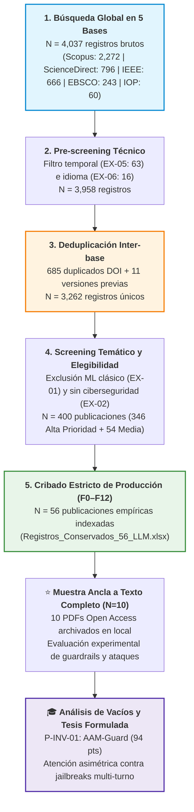

# 🛡️ Centro de Control: Universal Project System — Trabajo de Investigación (EPIS-UNU)

> [!abstract] Ficha Institucional y Académica
> - **Tesista:** Pedro Giovanni Ricra Figueroa
> - **Asignatura:** Trabajo de Investigación | **Ciclo:** X (Semestre 2026-II)
> - **Línea de Investigación:** Ciberseguridad
> - **Institución:** Escuela Profesional de Ingeniería de Sistemas — Universidad Nacional de Ucayali (EPIS-UNU)
> - **Protocolo:** PRISMA-ScR (*Preferred Reporting Items for Systematic reviews and Meta-Analyses extension for Scoping Reviews*)
> - **Marco Taxonómico:** MITRE ATLAS (*Adversarial Threat Landscape for Artificial-Intelligence Systems*)
> - **Proyecto de Tesis Seleccionado:** [[PRJ - Tesis AAM-Guard Atención Asimétrica|AAM-Guard — Desacoplamiento de Atención Asimétrica contra Contaminación Contextual Multi-Turno]] (Puntaje: 94/100)

---

## ⚡ Estado Operativo y Próximos Pasos

> [!tip] Próximas Acciones Prioritarias
> - [x] **Delimitación Temática y Matriz Institucional:** Culminada y aprobada (Secciones I a V en Word).
> - [x] **Búsqueda Booleana en 5 Bases Indexadas:** 4,037 registros recuperados y deduplicados a 3,262 únicos.
> - [x] **Cribado Sistemático y Auditoría HTTP:** Pipeline de 12 filtros (F0 a F12) con 56 registros conservados y 10 artículos ancla a texto completo.
> - [x] **Análisis Exhaustivo de Vacíos Científicos:** 10 fases culminadas (mapa del estado del arte, contradicciones, ranking multicriterio y selección de tesis).
> - [ ] **Próximo Paso Inmediato:** Implementar prototipo de la máscara de atención asimétrica ($M_{AAM}$) sobre `Llama-3.1-8B-Instruct` contra el benchmark *Crescendo*.
> - [ ] **Hito Semanal:** Ensayar el guion de sustentación oral (3:00 min) con diapositivas PPTX ante asesores EPIS-UNU.

---

## 🧭 Mapa de Navegación del Sistema (MOC)

```text
Trabajo de Investigación/
├── 📂 00_DASHBOARD/
│   ├── [[Dashboard Trabajo de Investigación|Dashboard General (Centro de Mando)]]
│   └── [[Mapa Conceptual Trabajo de Investigación.canvas|Mapa Conceptual Visual Interactivo]]
│
├── 📂 01_INBOX/
│   └── [[Inbox y Capturas Rápidas|Inbox y Capturas Rápidas (Triaje y Casos Pendientes)]]
│
├── 📂 02_PROJECTS/
│   ├── [[PRJ - Mapeo Sistemático PRISMA-ScR en LLMs|PRJ - Mapeo Sistemático PRISMA-ScR en LLMs]]
│   ├── [[PRJ - Delimitación Temática y Matriz Institucional|PRJ - Delimitación Temática y Matriz Institucional]]
│   ├── [[PRJ - Tesis AAM-Guard Atención Asimétrica|PRJ - Tesis AAM-Guard Atención Asimétrica]]
│   └── [[PRJ - Sustentación Oral y Defensa Ciclo X|PRJ - Sustentación Oral y Defensa Ciclo X]]
│
├── 📂 03_AREAS/
│   ├── [[AREA - Línea de Investigación en Ciberseguridad|AREA - Línea de Investigación en Ciberseguridad]]
│   └── [[AREA - Gestión Académica Ciclo X (2026-II)|AREA - Gestión Académica Ciclo X (Cronograma y Asesorías)]]
│
├── 📂 04_RESOURCES/
│   ├── 📁 Metodología y Protocolo/
│   │   ├── [[Protocolo PRISMA-ScR y Códigos de Exclusión]]
│   │   └── [[Ecuaciones de Búsqueda y Filtros por Base de Datos]]
│   ├── 📁 Taxonomía MITRE ATLAS/
│   │   ├── [[Mapa General MITRE ATLAS para LLMs]]
│   │   ├── [[AML.T0051 - Prompt Injection (Directo e Indirecto)]]
│   │   ├── [[AML.T0054 - Jailbreaking y Evasión Adversarial]]
│   │   ├── [[AML.T0018-T0020-T0099 - Data Poisoning y RAG Poisoning]]
│   │   └── [[AML.M0000 - Guardrails y Mecanismos de Mitigación]]
│   ├── 📁 Fichas de Literatura Ancla/ (10 Artículos Clave)
│   │   ├── [[Majewski et al. (2026) - Benchmark Empírico de Guardrails y Over-Refusal]]
│   │   ├── [[Vargas Yáñez & Tobón (2026) - Hive-AI Honeypots para APIs de LLMs]]
│   │   ├── [[IEEE Authors (2026) - PROMPTFUZZ Fuzzing Semántico para Jailbreaks]]
│   │   ├── [[Yuan et al. (2026) - RigorLLM Guardrails Resilientes ante Ataques Compuestos]]
│   │   ├── [[Zhang et al. (2026) - BackdoorAlign Mitigación de Backdoors en Fine-Tuning]]
│   │   ├── [[Liu et al. (2026) - Robustez Adversarial y Defensas en RAG Empresarial]]
│   │   ├── [[MDPI Authors (2026) - Middleware de Privacidad y Detección de Prompt Injection]]
│   │   ├── [[Schulhoff et al. (2024) - HackAPrompt Evaluación Empírica Global]]
│   │   ├── [[Chen et al. (2026) - Defensas contra Data Poisoning en LLMs Médicos]]
│   │   └── [[Santilli (2026) - D-SHIELD Descontextualización de Salvaguardas]]
│   ├── 📁 Síntesis y Métricas Empíricas/
│   │   ├── [[Matriz Comparativa de Guardrails Comerciales y de Código Abierto]]
│   │   └── [[Evaluación de Trade-offs Seguridad vs Latencia vs Over-Refusal]]
│   ├── 📁 Vacíos Científicos/
│   │   ├── [[Mapa del Estado del Arte y Taxonomía de Evidencia (2023–2026)]]
│   │   ├── [[Contradicciones Científicas y Debates Abiertos]]
│   │   └── [[Portafolio de Oportunidades y Ranking Multicriterio]]
│   └── 📁 Glosario y Terminología/
│       └── [[Diccionario de Términos Técnicos y Glosario de Sustentación]]
│
├── 📂 05_ARCHIVE/
│   ├── [[Archivo - Hitos Culminados Fases 1 a 3]]
│   └── [[Archivo - Log de Búsqueda Booleana Inicial (4037 Registros)]]
│
└── 📂 06_TEMPLATES/
    ├── [[Template - Proyecto]]
    ├── [[Template - Ficha de Literatura Ancla]]
    ├── [[Template - Área de Responsabilidad]]
    ├── [[Template - Asesoría y Reunión Docente]]
    └── [[Template - Revisión Diaria o Semanal]]
```

---

## 📊 Embudo PRISMA-ScR y Conciliación Muestral



---

## 🔗 Recursos Locales y Enlaces Verificados

- 📑 **Matriz Oficial Word (Secciones I a V):** [[MATRIZ_DELI_RICRA_FIGUEROA_PEDRO_GIOVANNI.docx|Abrir Matriz Oficial Word (DOCX)]]
- 📊 **Presentación Oficial de Sustentación:** [[MATRIZ_DELI_RICRA_FIGUEROA_PEDRO_GIOVANNI.pptx|Abrir Presentación Oficial PPTX (8 Diapositivas)]]
- 📈 **Base Maestra Consolidada (8 Hojas):** [[Base de Datos - 12.xlsx|Abrir Base Maestra Consolidada (XLSX)]]
- 📊 **Base Original 5 Fuentes (Identificación Inicial):** [[Base de Datos - Identificación Inicial.xlsx|Abrir Base Original 5 Fuentes (XLSX)]]
- 📚 **Textos Completos en PDF (10 Investigaciones Ancla):** [[Dashboard Trabajo de Investigación#📁 Fichas de Literatura Ancla/ (10 Artículos Clave)|Ver 10 Investigaciones Ancla en PDF (carpeta investigaciones/)]]
- 🔬 **Entregables de Vacíos Científicos:** [[Mapa del Estado del Arte y Taxonomía de Evidencia (2023–2026)|Abrir Análisis de Vacíos Científicos]]
- 🗺️ **Canvas Interactivo del Proyecto:** [[Mapa Conceptual Trabajo de Investigación.canvas|Abrir Mapa Visual del Proyecto]]
