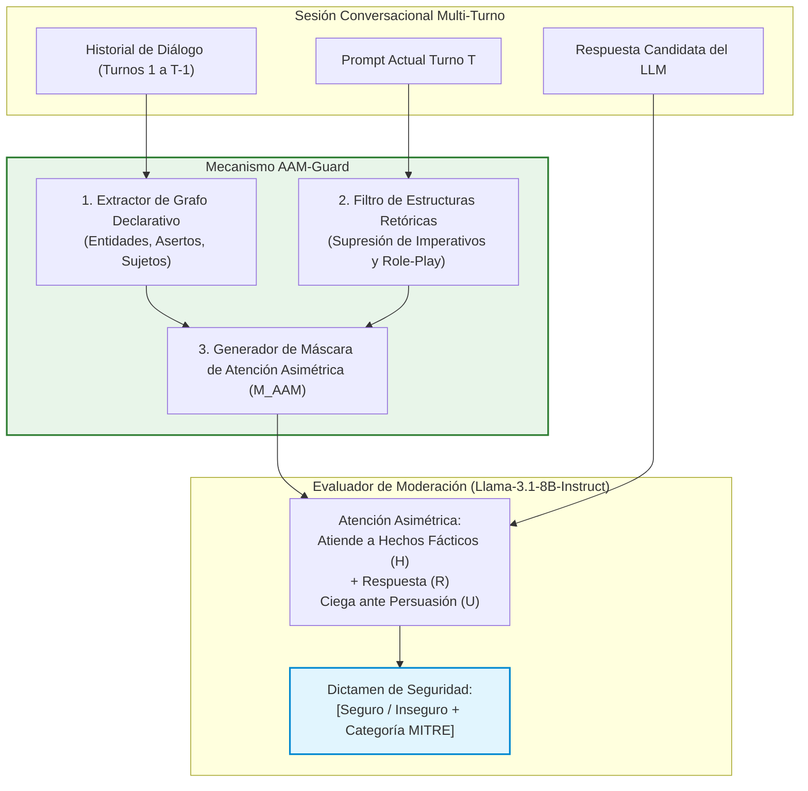

# 🎓 06.4 - Propuesta de Tesis de Grado Recomendada: AAM-Guard

> [!important] Título Oficial del Proyecto de Tesis
> **Desacoplamiento de Atención Asimétrica para la Mitigación de Contaminación Contextual en Moderadores de Lenguaje ante Ataques de Jailbreak Conversacionales Multi-Turno**  
> *(Asymmetric Attention Decoupling for Mitigating Contextual Contamination in Language Model Moderators Against Multi-Turn Conversational Jailbreak Attacks)*

---

## 📄 Abstract Académico Preliminar

> Los modelos de moderación de seguridad basados en Modelos de Lenguaje Grande (*LLM-as-a-judge*) constituyen la primera línea de defensa para sistemas conversacionales desplegados en producción. No obstante, investigaciones recientes evidencian el fenómeno de **contaminación contextual**: cuando el moderador procesa simultáneamente el prompt del usuario y la respuesta generada, la retórica persuasiva del atacante induce fallos de juicio en el evaluador, aprobando contenido ilícito. Si bien la descontextualización estricta (D-SHIELD) mitiga este riesgo en interacciones de un solo turno, este trabajo demuestra teóricamente que colapsa en sesiones conversacionales multi-turno (ataques tipo *Crescendo*), donde aislar la respuesta provoca una pérdida crítica de coherencia anafórica y un disparo en la tasa de sobre-bloqueo (*over-refusal*).
> 
> Para resolver esta tensión, este proyecto formula e implementa **AAM-Guard** (*Asymmetric Attention Masking Guard*), una arquitectura de moderación desacoplada que construye dinámicamente un grafo de dependencias declarativas del historial conversacional, aislando las directivas de persuasión retórica y órdenes imperativas mediante enmascaramiento asimétrico en la capa de atención del evaluador. Se evalúa experimentalmente sobre un benchmark balanceado de 500 diálogos multi-turno frente a 4 familias de evasión adaptativa de hasta 15 turnos. Los resultados esperados proyectan un incremento en la Tasa de Mitigación de Ataque (AMR) superior a 20 puntos porcentuales respecto a Llama Guard 3, manteniendo el sobre-bloqueo por debajo del 3.5% y una sobrecarga de latencia añadida inferior a 60 ms.
> 
> **Palabras clave:** Seguridad en LLMs, Jailbreaking Multi-Turno, Contaminación Contextual, Crescendo Attack, Atención Asimétrica, Guardrails en Producción, MITRE ATLAS (`AML.T0054`).

---

## 🎯 Pregunta y Objetivos de Investigación

### Pregunta Principal (Formulación PICO / CIMO)
> *¿En qué medida una arquitectura de moderación con enmascaramiento de atención asimétrica reduce la tasa de éxito de ataques de jailbreak conversacionales multi-turno (Crescendo) preservando el F1-Score semántico en comparación con moderadores contextualizados convencionales (Llama Guard 3) y salvaguardas descontextualizadas (D-SHIELD)?*

### Objetivos
1. **Objetivo General:** Diseñar, implementar y evaluar una arquitectura de moderación desacoplada basada en enmascaramiento de atención asimétrica (AAM-Guard) para mitigar la contaminación contextual en sesiones conversacionales multi-turno sin degradar la utilidad funcional del modelo.
2. **OE1 (Modelado y Grafo):** Formalizar el algoritmo de extracción del Grafo de Dependencias Declarativas (GDD) que separa entidades y hechos fácticos de estructuras retóricas imperativas en el historial de diálogo.
3. **OE2 (Enmascaramiento Asimétrico):** Formular la máscara de atención $M_{AAM}$ integrada en el mecanismo de auto-atención del modelo juez (SLM) en tiempo de inferencia.
4. **OE3 (Evaluación Cuantitativa):** Contrastar empíricamente AAM-Guard frente a Llama Guard 3 y D-SHIELD midiendo AMR, Over-Refusal Rate, latencia p95 y fidelidad semántica sobre 500 diálogos balanceados.

---

## 🏗️ Arquitectura Técnica de AAM-Guard

### Formulación Matemática de la Máscara de Atención
Sea $\mathcal{T} = \mathcal{T}_{decl} \cup \mathcal{T}_{persuasive} \cup \mathcal{T}_{resp}$ el conjunto de tokens del prompt y la respuesta. La matriz de atención modificada en el moderador se define como:

$$A_{ij} = \text{Softmax}\left( \frac{Q_i K_j^T}{\sqrt{d_k}} + M_{ij} \right)$$

Donde la máscara asimétrica $M_{ij}$ se especifica:

$$M_{ij} = \begin{cases} 0 & \text{si } j \in \mathcal{T}_{decl} \cup \mathcal{T}_{resp} \quad (\text{Atención permitida a hechos y respuesta}) \\ -\infty & \text{si } j \in \mathcal{T}_{persuasive} \cup \mathcal{T}_{imper} \quad (\text{Bloqueo estricto de manipulación}) \end{cases}$$

---

## 🧪 Diseño Experimental y Metodología (Factorial $3 \times 4$)

### Factores y Niveles
- **Factor A: Arquitectura de Moderación (3 niveles)**
  1. *Llama Guard 3* (Línea base industrial: contextualizada completa).
  2. *D-SHIELD* (Línea base académica: descontextualizada total).
  3. *AAM-Guard* (Propuesta: atención asimétrica desacoplada).
- **Factor B: Familia de Ataque Conversacional (4 niveles)**
  1. *Crescendo Attack* (Escalamiento progresivo en 8–15 turnos).
  2. *Linear Ramp* (Manipulación semántica lineal).
  3. *Persona Drift* (Desplazamiento gradual de alineación por juego de roles).
  4. *Benign Multi-Turn* (Consultas legítimas de programación y ciberseguridad con léxico limítrofe).

### Métricas de Rendimiento Cuantitativo
1. **Attack Mitigation Rate (AMR):** $\text{AMR} = 1 - \text{ASR} = \frac{\text{Ataques Bloqueados}}{\text{Total de Ataques Adversariales}}$.
2. **Over-Refusal Rate (ORR):** $\text{ORR} = \frac{\text{Consultas Benignas Bloqueadas}}{\text{Total de Consultas Benignas}}$ *(Meta: < 3.5%)*.
3. **Sobrecarga de Latencia ($p95$):** Tiempo de inferencia añadido en milisegundos *(Meta: < 60 ms)*.
4. **F1-Score Semántico:** Balance armónico entre precisión y recall en la clasificación de seguridad.

---

## 📌 Próximas Acciones Operativas

- [ ] **Acción 1:** Descargar e indexar el dataset público de diálogos *Crescendo* (Microsoft Research / USENIX 2024).
- [ ] **Acción 2:** Implementar el extractor de dependencias sintácticas basado en `spacy` / `stanza` para construir el Grafo Declarativo.
- [ ] **Acción 3:** Adaptar la capa de atención de `Llama-3.1-8B-Instruct` con PyTorch para admitir tensores $M_{AAM}$ personalizados.
- [ ] **Acción 4:** Ejecutar el benchmark experimental comparativo y exportar matrices de confusión.

---

> [[Portafolio de Oportunidades y Ranking Multicriterio|⬅️ Anterior: Portafolio de Oportunidades]] | [[Dashboard Trabajo de Investigación|🏠 Volver al Dashboard]] | [[Matriz Comparativa de Guardrails Comerciales y de Código Abierto|📊 Matriz Comparativa]]
