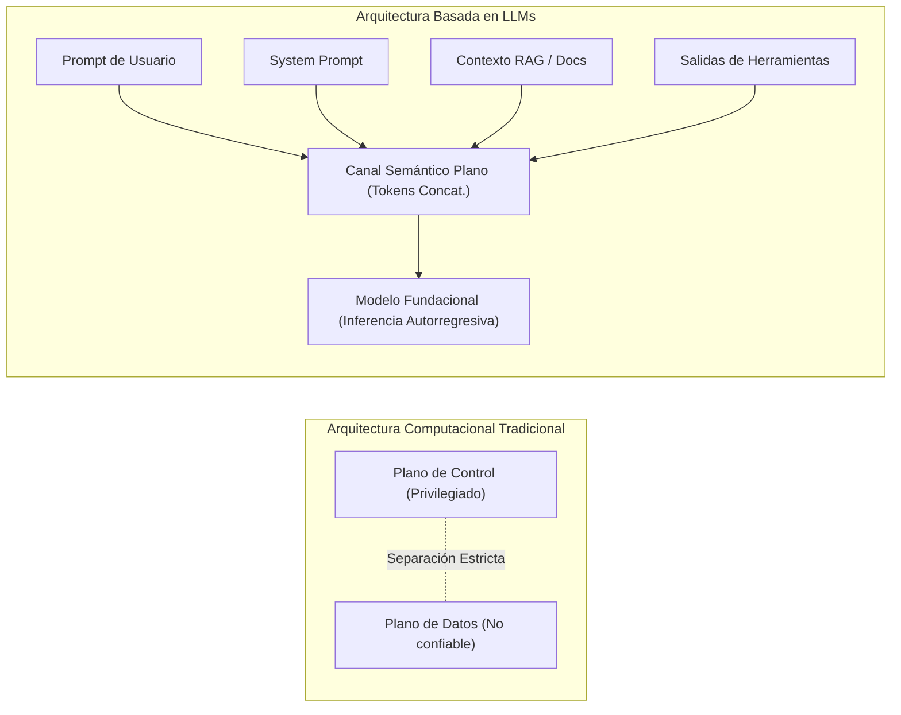

---
title: Mapa del Estado del Arte y Taxonomía de Evidencia (2023–2026) en Ciberseguridad de LLMs
aliases:
  - Mapa del Estado del Arte y Taxonomía de Evidencia (2023–2026)
  - Estado del Arte
  - Mapa del Estado del Arte
  - Taxonomía de Evidencia
tags:
  - estado-del-arte
  - vacios-cientificos
  - mitre-atlas
  - ciberseguridad
  - llm
tipo: investigacion
proyecto: "[[PRJ-2026-001_Mapeo-Sistematico-LLMs]]"
area: Trabajo de Investigación
estado: vigente
prioridad: 2
created: 2026-11-09
updated: 2026-11-09
author: Pedro Giovanni Ricra Figueroa
asignatura: Trabajo de Investigación
ciclo: X (2026-II)
---

# 🗺️ Mapa del Estado del Arte y Taxonomía de Evidencia (2023–2026) (2023–2026)

> [!abstract] Marco Epistemológico y Diagnóstico Estructural
> El despliegue de Modelos de Lenguaje Grande (*LLMs*) y sistemas agénticos autónomos ha originado un cambio paradigmático en ciberseguridad. A diferencia de los sistemas tradicionales donde existe una separación física estricta entre el **plano de control** (código ejecutable) y el **plano de datos** (entradas de usuario no confiables), en los Transformers autorregresivos ambos planos colapsan en un **único canal semántico plano** (*flat token sequence*). Las directivas de sistema (*system prompts*), el contexto recuperado (*RAG*) y la entrada de usuarios compiten por la atención del modelo, creando una superficie de ataque continua.

---

## 🏛️ Colapso de Planos en la Arquitectura Transformer

---

## 📊 Grado de Madurez y Volumen de Evidencia por Categoría

| Categoría | Subcategorías y Vectores Clave | Volumen de Evidencia | Madurez Científica | Estatus de Resolución | Mapeo ATLAS |
| :--- | :--- | :---: | :---: | :--- | :---: |
| **A. Prompt Injection** | Directo, Indirecto, Inyección en Agentes y Tool-Use | **Muy Alto** (41% corpus) | Media-Alta | **No resuelto** (Tratado con heurísticas superficiales) | `AML.T0051.000` / `AML.T0051.001` |
| **B. Jailbreaking** | Sufijos GCG, AutoDAN, Persuasión, Multi-Turn (Crescendo) | **Extenso** (37% corpus) | Alta (en laboratorio) | **Parcialmente contenido** en 1-turn; **Crítico** en multi-turn | `AML.T0054` |
| **C. Data Poisoning** | Fine-Tuning Poisoning (FJAttack), Backdoors, Degradación LoRA | **Moderado** (13% corpus) | Media | **Resuelto parcialmente** en lab; **Crítico** en LMaaS | `AML.T0018` / `AML.T0020` |
| **D. RAG Poisoning** | Ranking Manipulation, Inyección Contextual Indirecta | **Emergente** (9% corpus) | Baja-Media | **Abierto / Crítico** (Vulnerabilidad estructural sistémica) | `AML.T0099` |
| **E. Defensas Algorítmicas** | Guardrails desacoplados, SLMs locales, Descontextualización | **Muy Extenso** (44.5% corpus) | Media | **Crisis de Trade-off** (Over-Refusal vs Latencia vs ASR) | `AML.M0000` |
| **F. Seguridad de Agentes** | Confused Deputy, Invocación no autorizada de APIs | **Incipiente** (<5% empírico) | Muy Baja | **Completamente Abierto** (Falta de modelos formales) | `AML.T0053` |

---

## 🔬 Síntesis Crítica por Categoría

### 1. Inyección de Prompts (`AML.T0051`)
- **Inyección Directa (`AML.T0051.000`):** El estudio global [[Schulhoff et al. (2024) - HackAPrompt Evaluación Empírica Global|HackAPrompt (Schulhoff et al., 2024)]] con 600,000+ intentos humanos demostró que las defensas basadas puramente en *prompt engineering* (advertencias en system prompts o filtros de palabras clave) son sistemáticamente vulneradas mediante *Compound Instructions*, *Payload Splitting* y *Refusal Suppression*.
- **Inyección Indirecta (`AML.T0051.001`):** [[Vargas Yáñez & Tobón (2026) - Hive-AI Honeypots para APIs de LLMs|Vargas Yáñez & Tobón (Springer 2026)]] recopilaron telemetría real de 16,683 ataques procedentes de 50 países contra APIs de IA generativa, probando que los atacantes usan metadatos HTTP, User-Agents y textos de terceros para forzar la exfiltración de credenciales y secuestrar herramientas (*tool calling*).
- **Fuzzing Automatizado:** [[IEEE Authors (2026) - PROMPTFUZZ Fuzzing Semántico para Jailbreaks|PROMPTFUZZ (Yu et al., IEEE TDSC 2026)]] evidenció que mutaciones algorítmicas guiadas por fitness alcanzan un **82.4% de ASR** evadiendo Azure AI Safety y OpenAI Moderation en el 65% de casos.

### 2. Jailbreaking y Evasión Adversarial (`AML.T0054`)
- **Optimización de Gradiente:** GCG (*Greedy Coordinate Gradient*) y AutoDAN demuestran que sufijos adversariales optimizados en modelos abiertos se transfieren exitosamente a modelos comerciales cerrados (GPT-4, Claude).
- **Fallas Estructurales de Guardrails:** [[Majewski et al. (2026) - Benchmark Empírico de Guardrails y Over-Refusal|Majewski et al. (IEEE Access 2026)]] demostraron empíricamente que los guardrails comerciales líderes (Llama Guard, NeMo, AWS Bedrock Guardrails, Azure AI Content Safety) sufren de hasta **18.4% de sobre-bloqueo (*over-refusal*)** y añaden entre **140 ms y 620 ms** de latencia.
- **Descubrimiento de la "Contaminación Contextual":** [[Santilli (2026) - D-SHIELD Descontextualización de Salvaguardas|Santilli (Information and Software Technology, 2026)]] descubrió que cuando un moderador evalúa simultáneamente el prompt y la respuesta, el evaluador es engañado psicológicamente por la retórica del atacante. Su propuesta **D-SHIELD** incrementa la mitigación al 94.7% mediante descontextualización estricta.

### 3. Envenenamiento de Datos y Fine-Tuning (`AML.T0018` / `AML.T0020`)
- En servicios de *Language-Model-as-a-Service* (LMaaS), inyectar menos de 50 muestras maliciosas en datasets de adaptación (LoRA) basta para crear backdoors duraderos (FJAttack). [[Zhang et al. (2026) - BackdoorAlign Mitigación de Backdoors en Fine-Tuning|Zhang et al. (2026)]] propusieron *BackdoorAlign* para mitigar este riesgo durante la alineación por preferencias.
- En dominios regulados como la medicina, [[Chen et al. (2026) - Defensas contra Data Poisoning en LLMs Médicos|Chen et al. (2026)]] reportaron que el envenenamiento de datos clínicos altera diagnósticos manteniendo una alta perplejidad sintáctica indistinguible de textos benignos.

### 4. RAG Poisoning y Manipulación de Recuperación (`AML.T0099`)
- [[Liu et al. (2026) - Robustez Adversarial y Defensas en RAG Empresarial|Liu et al. (2026)]] y Pfrommer et al. (2024) demostraron que inyectar pasajes estratégicos en bases vectoriales permite a un atacante manipular el ranking semántico (Top-1 promotion > 87.5%) forzando al LLM a emitir recomendaciones sesgadas o exfiltrar información interna.

---

> [[Dashboard Trabajo de Investigación|🏠 Volver al Dashboard]] | [[Contradicciones Científicas y Debates Abiertos|➡️ Siguiente: Contradicciones Científicas]]
