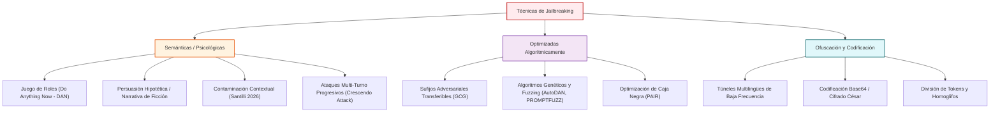

---
title: AML.T0054 - Jailbreaking y Evasión Adversarial [AML.T0054]
aliases:
  - AML.T0054 - Jailbreaking y Evasión Adversarial
  - Jailbreaking
  - Evasión Adversarial
  - AML.T0054
tags:
  - mitre-atlas
  - jailbreak
  - evasion
  - guardrails
tipo: concepto
area: Trabajo de Investigación
estado: vigente
priority: high
created: 2026-08-15
updated: 2026-11-09
author: Pedro Giovanni Ricra Figueroa
asignatura: Trabajo de Investigación
ciclo: X (2026-II)
---

# 🔓 AML.T0054: LLM Jailbreaking y Evasión de Políticas de Seguridad

> [!abstract] Definición y Mecánica (MITRE ATLAS AML.T0054)
> El **Jailbreak** consiste en inducir al modelo a evadir sus políticas éticas, legales o de alineamiento operacional (*Safety Alignment*), generando contenidos prohibidos (ciberataques, fraude, desinformación, manipulación de privilegios).
> A diferencia de la inyección genérica, el Jailbreak está diseñado específicamente para derrotar los mecanismos de RLHF (*Reinforcement Learning from Human Feedback*), DPO (*Direct Preference Optimization*) y guardrails perimetrales.

---

## ⚔️ Taxonomía de Técnicas de Evasión

---

## 📈 Hallazgos Empíricos en la Literatura

1. **Fragilidad de Guardrails Comerciales:**
   - El estudio de [[Majewski et al. (2026) - Benchmark Empírico de Guardrails y Over-Refusal|Majewski et al. (2026)]] demostró que guardrails como *Llama Guard* o *Azure AI Content Safety* logran exactitudes entre 93.9% y 96.8% ante ataques estándar, pero sufren degradación severa ante sufijos optimizados y ataques compuestos.
2. **Fenómeno de Contaminación Contextual y Multi-Turno:**
   - Descrito por [[Santilli (2026) - D-SHIELD Descontextualización de Salvaguardas|Santilli (2026)]]: cuando un clasificador de seguridad analiza conjuntamente el prompt del atacante y la respuesta del LLM, la retórica persuasiva del prompt contamina el juicio del evaluador.
   - En sesiones multi-turno (ataques *Crescendo*), la escalada gradual de hostilidad en 8–15 turnos elude el 100% de los filtros perimetrales estándar, brecha que aborda la tesis [[PRJ - Tesis AAM-Guard Atención Asimétrica|AAM-Guard]].
3. **Fuzzing Semántico Continuo:**
   - La herramienta [[IEEE Authors (2026) - PROMPTFUZZ Fuzzing Semántico para Jailbreaks|PROMPTFUZZ (2026)]] demostró que mutando automáticamente operadores semánticos es posible descubrir más de 1,400 jailbreaks desconocidos con tasas de éxito superiores al 65%.

---

> [[AML.T0051 - Prompt Injection (Directo e Indirecto)|⬅️ Volver a Prompt Injection]] | [[Dashboard Trabajo de Investigación|🏠 Dashboard]] | [[AML.T0018-T0020-T0099 - Data Poisoning y RAG Poisoning|➡️ Siguiente: Data Poisoning]]
