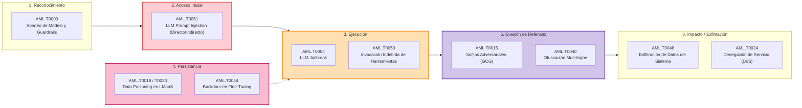

---
title: Mapa General MITRE ATLAS para LLMs
aliases:
  - Mapa General MITRE ATLAS para LLMs
  - MITRE ATLAS
  - Taxonomía MITRE ATLAS
  - Matriz ATLAS
tags:
  - mitre-atlas
  - ciberseguridad
  - taxonomía
  - llm
tipo: concepto
area: Trabajo de Investigación
estado: vigente
priority: high
created: 2026-08-15
updated: 2026-11-09
author: Pedro Giovanni Ricra Figueroa
asignatura: Trabajo de Investigación
ciclo: X (2026-II)
---

# 🛡️ Matriz Taxonómica MITRE ATLAS aplicada a LLMs en Producción

> [!abstract] Marco Conceptual
> **MITRE ATLAS** (*Adversarial Threat Landscape for Artificial-Intelligence Systems*) es la base de conocimiento global de tácticas, técnicas y procedimientos (TTPs) adversariales específicos contra sistemas de Inteligencia Artificial. A diferencia de marcos genéricos como MITRE ATT&CK o listados no estructurados, ATLAS modela formalmente la superficie de ataque del aprendizaje automático adversarial (*Adversarial Machine Learning* - AML).

---

## 🗺️ Tácticas y Técnicas ATLAS en el Ciclo de Vida de los LLMs

---

## 📊 Matriz Comparativa de TTPs Críticos en el Corpus (N=400 / Muestra N=56)

| Táctica MITRE ATLAS | Identificador | Técnica / Vector | Mecanismo de Explotación | Defensas Reportadas en Literatura | Estudios Ancla Clave |
| :--- | :---: | :--- | :--- | :--- | :--- |
| **Initial Access / Execution** | `AML.T0051` | [[AML.T0051 - Prompt Injection (Directo e Indirecto)|LLM Prompt Injection (Directo .000 e Indirecto .001)]] | Manipulación del plano de control en el canal semántico plano e inyección indirecta a través de fuentes RAG y web. | Control de flujo de información (IFC), SLMs locales de sanitización ([[MDPI Authors (2026) - Middleware de Privacidad y Detección de Prompt Injection|MDPI 2026]]), Honey-LLMs ([[Vargas Yáñez & Tobón (2026) - Hive-AI Honeypots para APIs de LLMs|Hive-AI 2026]]). | [[Schulhoff et al. (2024) - HackAPrompt Evaluación Empírica Global|HackAPrompt (2024)]], [[Vargas Yáñez & Tobón (2026) - Hive-AI Honeypots para APIs de LLMs|Vargas Yáñez (2026)]], [[IEEE Authors (2026) - PROMPTFUZZ Fuzzing Semántico para Jailbreaks|PROMPTFUZZ (2026)]] |
| **Defense Evasion** | `AML.T0054` | [[AML.T0054 - Jailbreaking y Evasión Adversarial|LLM Jailbreak & Sufijos Adversariales]] | Bypass de políticas de alineamiento (RLHF/DPO) mediante persuasión, juego de roles, sufijos GCG/AutoDAN y multi-turno (Crescendo). | Descontextualización (D-SHIELD), Guardrails OOD (RigorLLM), Atención Asimétrica ([[PRJ - Tesis AAM-Guard Atención Asimétrica|AAM-Guard]]). | [[Majewski et al. (2026) - Benchmark Empírico de Guardrails y Over-Refusal|Majewski et al. (2026)]], [[Santilli (2026) - D-SHIELD Descontextualización de Salvaguardas|Santilli (2026)]], [[Yuan et al. (2026) - RigorLLM Guardrails Resilientes ante Ataques Compuestos|RigorLLM (2026)]] |
| **Persistence / Collection** | `AML.T0018` / `AML.T0020` / `AML.T0099` | [[AML.T0018-T0020-T0099 - Data Poisoning y RAG Poisoning|Data Poisoning & RAG Manipulation]] | Inyección de pasajes corruptos en repositorios vectoriales y backdoors activables por triggers en fine-tuning de LMaaS. | Alineación robusta de backdoors (BackdoorAlign), Filtrado de consenso en RAG, Purificación de gradientes. | [[Zhang et al. (2026) - BackdoorAlign Mitigación de Backdoors en Fine-Tuning|Zhang et al. (2026)]], [[Liu et al. (2026) - Robustez Adversarial y Defensas en RAG Empresarial|Liu et al. (2026)]], [[Chen et al. (2026) - Defensas contra Data Poisoning en LLMs Médicos|Chen et al. (2026)]] |
| **Mitigation & Detection** | `AML.M0000` | [[AML.M0000 - Guardrails y Mecanismos de Mitigación|Guardrails y Arquitecturas de Salvaguarda]] | Inspección perimetral de prompts y completaciones con SLMs dedicados y clasificadores heurísticos en cascada. | Llama Guard 3, NeMo Guardrails, AWS Bedrock Guardrails, Azure AI Content Safety, AAM-Guard. | [[Majewski et al. (2026) - Benchmark Empírico de Guardrails y Over-Refusal|Majewski et al. (2026)]], [[Yuan et al. (2026) - RigorLLM Guardrails Resilientes ante Ataques Compuestos|Yuan et al. (2026)]], [[Santilli (2026) - D-SHIELD Descontextualización de Salvaguardas|Santilli (2026)]] |

---

> [[Dashboard Trabajo de Investigación|🏠 Dashboard]] | [[AML.T0051 - Prompt Injection (Directo e Indirecto)|➡️ Siguiente: Prompt Injection]]
