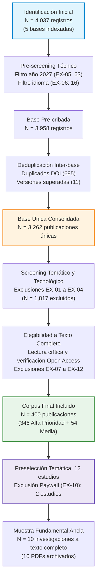

# 📋 Protocolo de Selección y Cribado PRISMA-ScR

> [!abstract] Resumen Metodológico
> La selección de literatura se ejecuta bajo las directrices del protocolo internacional **PRISMA-ScR** (*Preferred Reporting Items for Systematic reviews and Meta-Analyses extension for Scoping Reviews*). El flujo comprende 6 etapas secuenciales y auditables para transformar 4,037 registros brutos en un corpus riguroso de 400 publicaciones evaluadas (346 de prioridad alta y 54 de prioridad media) y 10 investigaciones fundamentales ancla (con texto completo disponible en Open Access).

---

## 🔄 Fases del Flujo de Trabajo PRISMA-ScR

---

## 🚫 Códigos Formales de Exclusión (EX-01 a EX-12)

Cada exclusión registrada en el dataset maestro ([[Base de Datos - 12.xlsx|Base de Datos - 12.xlsx]], hoja `4. Excluidos con justificación`) cuenta con su codificación explícita y justificación técnica:

| Código | Denominación del Criterio | Descripción Operacional | Impacto (Registros) |
| :---: | :--- | :--- | :---: |
| **EX-01** | Filtro Tecnológico | No estudian LLMs como activo de seguridad (tratan Machine Learning clásico, redes convolucionales, visión por computador o SVM). | 563 |
| **EX-02** | Filtro Temático | Artículos sin relación con ciberseguridad adversaria de modelos generativos (usos pedagógicos, chatbots de soporte sin análisis de amenazas). | 757 |
| **EX-03** | Mención Superficial | Mencionan términos como *Prompt Injection* o *Jailbreak* únicamente como contexto o palabra clave sin desarrollar pruebas experimentales ni defensas. | 327 |
| **EX-04** | Ciberseguridad Convencional | El LLM es usado como herramienta para tareas tradicionales (detección de phishing, análisis de malware x86, SOC) sin evaluar la seguridad del propio LLM. | 170 |
| **EX-05** | Fuera de Ventana Temporal | Publicaciones registradas con fecha futura (año 2027) o anteriores a 2023, fuera de la ventana delimitada 2023–2026. | 63 |
| **EX-06** | Idioma No Admitido | Textos completos redactados en chino, ruso u otros idiomas no admitidos (se admiten español e inglés). | 22 |
| **EX-07** | Duplicados Inter-base | Registros idénticos indexados simultáneamente en Scopus, IEEE Xplore, ScienceDirect o EBSCO identificados por DOI idéntico. | 685 |
| **EX-08** | Metadatos de Actas | Registros correspondientes a portadas de congresos, prefacios, actas completas (*conference proceedings*) sin autoría de investigación unitaria. | 57 |
| **EX-09** | Calidad e Insuficiencia | Documentos con metodología no reproducible, preprints retirados o ausencia de evidencia experimental mínima. | 26 |
| **EX-10** | Restricción de Acceso (Paywall) | Artículos sin disponibilidad de texto completo en acceso abierto (*Open Access*), imposibilitando la auditoría reproducible de resultados. | 2 |
| **EX-11** | Versiones Preliminares | Versiones borrador de conferencias superadas por la publicación definitiva extendida en revista científica arbitrada. | 11 |
| **EX-12** | Redundancia Temática | Artículos que replican exactamente datasets y ataques ya consolidados en publicaciones ancla previas sin aportar nuevas variantes ni defensas. | 18 |

---

## 🎯 Criterios de Ponderación para Inclusión

Los 400 estudios incluidos fueron categorizados en la matriz de extracción según su proximidad con escenarios reales de producción:

1. **Prioridad Alta (N=346):**
   - Publicaciones con evidencia empírica directa sobre modelos fundacionales (GPT-4, Llama 2/3, Claude, Gemini, Mistral).
   - Pruebas contra guardrails comerciales (*AWS Bedrock Guardrails, Azure AI Content Safety, Llama Guard, NeMo*).
   - Métricas cuantitativas explícitas ($ASR$, latencia en ms, tasa de sobre-bloqueo *over-refusal*).
2. **Prioridad Media (N=54):**
   - Propuestas teóricas de modelado de amenazas, revisiones taxonómicas secundarias o marcos defensivos evaluados únicamente en simulaciones de laboratorio sintéticas.

---

> [[Dashboard Trabajo de Investigación|⬅️ Volver al Dashboard]] | [[Ecuaciones de Búsqueda y Filtros por Base de Datos|➡️ Siguiente: Ecuaciones de Búsqueda]]
