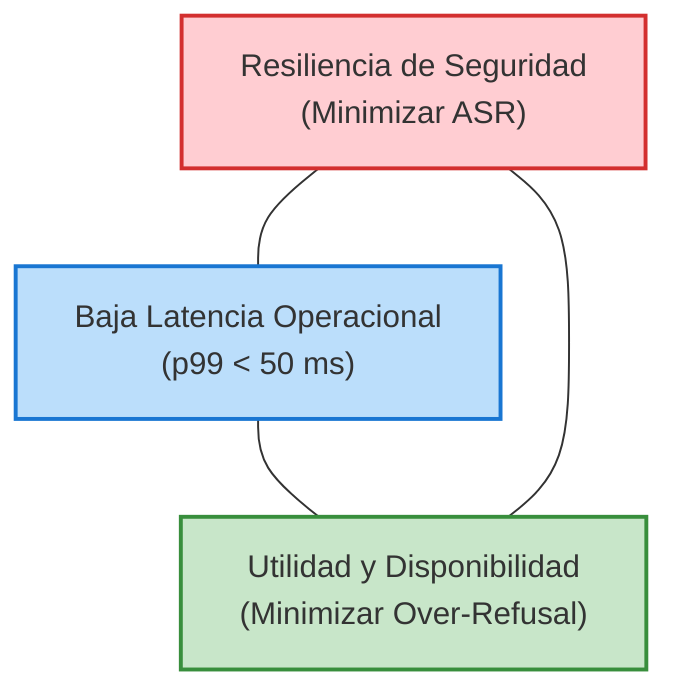

# ⚖️ El Trilema de los Guardrails en Producción: Seguridad vs. Latencia vs. Utilidad

> [!important] Planteamiento del Problema
> Uno de los hallazgos medulares del presente trabajo de investigación es la formalización del **Trilema de Seguridad en LLMs**:
> Ningún mecanismo perimetral convencional puede maximizar simultáneamente la **resiliencia contra ataques** ($1 - ASR$), la **latencia ultrabaja** ($t_{inferencia} \to 0$) y la **disponibilidad funcional / utilidad** ($1 - OverRefusal$).

---

## 📐 Modelado del Trilema

---

## 🔬 Análisis de los Vértices del Trade-off

### 1. El Costo del Sobre-Bloqueo (*Over-Refusal*)
- Cuando las empresas configuran guardrails con umbrales de seguridad ultra-estrictos para evitar incidentes reputacionales, el sistema rechaza sistemáticamente peticiones benignas que contienen léxico sensible:
  - Preguntas sobre auditoría de redes o pentesting defensivo.
  - Consultas sobre eventos históricos de guerra o criminalística.
  - Análisis de muestras de código con palabras reservadas comunes en explotación.
- **Evidencia cuantitativa:** [[Majewski et al. (2026) - Benchmark Empírico de Guardrails y Over-Refusal|Majewski et al. (2026)]] reporta un falso rechazo de hasta **18.4%** en servicios comerciales en la nube.

### 2. La Sobrecarga de Latencia (*Inference Overhead*)
- Cada llamada a un guardrail secundario (como un clasificador Llama Guard de 8B parámetros o una API remota) añade entre **100 y 400 milisegundos** antes de que el primer token comience a generarse (*Time-To-First-Token* - TTFT).
- En aplicaciones de agentes con 10 o más llamadas intermedias a herramientas, esta latencia acumulada degrada la viabilidad interactiva del sistema en un 200–400%.

$$SUR = \frac{\text{Peticiones Benignas Aprobadas y Completadas con Éxito}}{\text{Peticiones Maliciosas Bloqueadas} + \text{Sobrecosto de Latencia Relativa}}$$

Una defensa óptima es aquella que maximiza el $SUR$, situándose en la frontera de Pareto de la curva de compensación, principio rector detrás de la propuesta [[PRJ - Tesis AAM-Guard Atención Asimétrica|AAM-Guard]].

---

> [[Matriz Comparativa de Guardrails Comerciales y de Código Abierto|⬅️ Volver a Matriz Comparativa]] | [[Dashboard Trabajo de Investigación|🏠 Dashboard]] | [[Contradicciones Científicas y Debates Abiertos|⚡ Siguiente: Contradicciones Científicas]]
