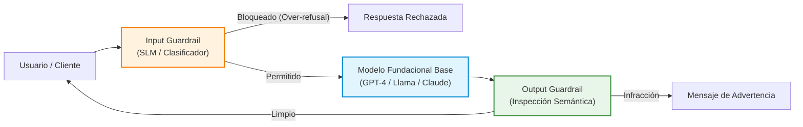

# 🛡️ Guardrails y Mecanismos de Mitigación en Producción

> [!abstract] Definición de Guardrail (MITRE ATLAS AML.M0000)
> Un **Guardrail** es una capa arquitectónica perimetral desacoplada del modelo fundacional que intercepta las entradas (*Input Guardrails*) y las salidas generadas (*Output Guardrails*) para detectar y bloquear contenidos que infrinjan políticas de seguridad, sin necesidad de reentrenar el modelo base.

---

## 🏗️ Arquitectura Típica de Guardrails Desacoplados

---

## 🔍 Soluciones Líderes Analizadas en la Literatura

| Solución | Proveedor / Tipo | Paradigma Técnico | Ventajas Principales | Limitaciones Críticas |
| :--- | :--- | :--- | :--- | :--- |
| **Llama Guard (1/2/3)** | Meta (Open Source) | SLM especializado entrenado en MLCommons Safety Taxonomy | Ligero, autohospedable, interpretable con códigos de categoría | Sobrecarga de inferencia adicional; susceptible a sufijos GCG y contaminación contextual |
| **NeMo Guardrails** | NVIDIA (Open Source) | Flujos lógicos programables en lenguaje Colang | Control estricto de temas y llamadas a herramientas (agentes) | Complejidad de configuración; latencia elevada en flujos multietapa (190–430 ms) |
| **AWS Bedrock Guardrails** | Amazon Web Services | Servicio gestionado en la nube con filtros por categorías | Integración empresarial nativa, filtros PII y enmascaramiento | Caja negra propietaria; latencia de red añadida (120–310 ms); over-refusal 13.9% |
| **Azure AI Content Safety** | Microsoft Azure | Modelos multimodales de detección de severidad (0–7) | Alta precisión en categorías severas, detección de jailbreaks | Frecuente sobre-bloqueo (*over-refusal de 14.8%*) en consultas técnicas benignas |
| **D-SHIELD** | Santilli (2026) | Descontextualización de salvaguarda | Elimina la contaminación contextual del atacante; bajo costo | Colapsa en sesiones conversacionales multi-turno por pérdida de anáforas |
| **RigorLLM** | Yuan et al. (2026) | Detección fuera de distribución (OOD) y KNN semántico | Resiliente ante ataques adaptativos combinados; FPR < 2% | Requiere base de conocimiento de embeddings actualizada |
| **AAM-Guard** | Propuesta Tesis (2026) | Desacoplamiento con Atención Asimétrica | Resuelve la contaminación contextual en multi-turno; AMR > 90% | Requiere parsing dinámico de dependencias declarativas en tiempo real |

---

> [[AML.T0018-T0020-T0099 - Data Poisoning y RAG Poisoning|⬅️ Volver a Data Poisoning]] | [[Dashboard Trabajo de Investigación|🏠 Dashboard]] | [[Matriz Comparativa de Guardrails Comerciales y de Código Abierto|📊 Siguiente: Matriz Comparativa]]
