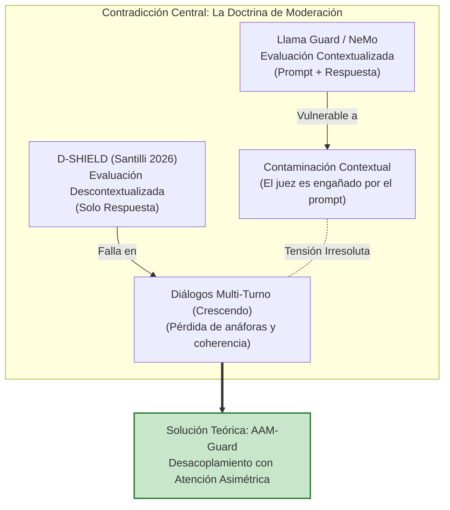

# ⚡ 06.2 - Contradicciones Científicas, Tensiones Empíricas y Debates Abiertos

> [!abstract] Diagnóstico de Controversias Metodológicas
> En la literatura científica sobre seguridad de LLMs (2023–2026), diversas investigaciones que evalúan las mismas familias de modelos o arquitecturas de defensa reportan resultados incompatibles. Esta discrepancia no surge de la estocasticidad de los modelos, sino de:
> 1. El abismo entre benchmarks sintéticos cerrados y telemetría de producción abierta.
> 2. Diseños muestrales reducidos que ocultan la cola larga de falsos positivos (*over-refusal*).
> 3. El conflicto entre la necesidad de evaluar el contexto histórico y la vulnerabilidad de intoxicación retórica (*contaminación contextual*).

---

## 💥 Las 5 Contradicciones Estructurales del Corpus

### 1. Paradoja de Eficacia vs. Sobre-Bloqueo (*Over-Refusal*)
- **Tensión:** [[Majewski et al. (2026) - Benchmark Empírico de Guardrails y Over-Refusal|Majewski et al. (IEEE Access 2026)]] (*N=1,186*) demuestran que los guardrails líderes en la nube sufren de hasta un **18.4% de sobre-bloqueo (*over-refusal*)** en XSTest, rechazando consultas legítimas de programación y ciberseguridad. En contraste, [[MDPI Authors (2026) - Middleware de Privacidad y Detección de Prompt Injection|Ait Hsine & Arabo (MDPI 2026)]] aseguran alcanzar **100% de recall y 0% de falsos positivos** con un middleware ligero evaluado sobre solo 120 casos artificiales.
- **Causa Raíz:** *Entrelazamiento léxico en el espacio de embeddings*: términos legítimos de ciberseguridad defensiva (*"auditar inyección SQL"*) se solapan geométricamente con intenciones ilícitas (*"ejecutar inyección SQL contra banco"*).
- **Pregunta Abierta:** *¿Cuál es el límite teórico de la frontera de Pareto entre ASR y Over-Refusal bajo lenguaje con vocabulario técnico limítrofe?*

---

### 2. Doctrina de Moderación: ¿Contextualización o Descontextualización? (Contradicción Nuclear)
- **Tensión:**
  - **Llama Guard (Meta) & NeMo (NVIDIA):** Sostienen como axioma fundacional que un evaluador de seguridad **debe leer el prompt del usuario junto a la respuesta generada** para discernir intenciones ambiguas.
  - **D-SHIELD ([[Santilli (2026) - D-SHIELD Descontextualización de Salvaguardas|Santilli, 2026]]):** Descubre la **"Contaminación Contextual"**: cuando el moderador lee el prompt del atacante, su retórica persuasiva sesga al juez, aprobando respuestas dañinas. Evaluar **únicamente la respuesta descontextualizada** sube la mitigación del 68.2% al **94.7%** y reduce la latencia en un **38%**.
- **La Fractura Científica:** La descontextualización total de Santilli resuelve el problema en interacciones de **1 solo turno**, pero colapsa en sesiones **multi-turno** (como ataques tipo *Crescendo*), donde una respuesta aislada pierde anáforas y el moderador no sabe si la respuesta responde a un contexto benigno o a un jailbreak distribuido.
- **Oportunidad de Solución:** Crear un mecanismo de **Atención Asimétrica** que preserve entidades fácticas del historial sin absorber la retórica manipulativa del atacante.

---

### 3. Respuesta ante Incidentes: Bloqueo Rígido vs. Decepción Activa (*Honeypots*)
- **Tensión:** La industria aplica bloqueo determinista perimetral (HTTP 403 / mensajes de rechazo). [[Vargas Yáñez & Tobón (2026) - Hive-AI Honeypots para APIs de LLMs|Vargas Yáñez & Tobón (2026)]] demuestran en producción que esto le da feedback inmediato al atacante para refinar su exploit, manteniendo un **54.8% de evasión**. Al implementar **decepción activa (Honey-LLMs)**, el atacante cree haber tenido éxito, reduciendo la tasa de evasión en producción al **9.3%** (-45.5 pp).

---

### 4. Fine-Tuning y Alineación: Resiliencia vs. Catastrophic Forgetting
- **Tensión:** Métodos como *BackdoorAlign* ([[Zhang et al. (2026) - BackdoorAlign Mitigación de Backdoors en Fine-Tuning|Zhang et al., 2026]]) eliminan backdoors en la adaptación por preferencias (DPO), pero penalizan la fluidez y capacidad general del modelo en un 6.8%–11.2%, reabriendo el debate sobre si la alineación debe ser intrínseca o desacoplada en tiempo de inferencia.

---

### 5. RAG: Búsqueda Semántica Densa vs. Vulnerabilidad de Re-Ranking
- **Tensión:** La optimización de embeddings densos mejora la recuperación de pasajes relevantes, pero los cross-encoders de re-ranking son ciegos ante la manipulación adversarial de rankings ([[Liu et al. (2026) - Robustez Adversarial y Defensas en RAG Empresarial|Liu et al., 2026]] / Pfrommer et al., 2024), donde pasajes con alta densidad de palabras clave maliciosas desplazan a documentos legítimos al Top-1 con un éxito > 87.5%.

---

---

> [[Mapa del Estado del Arte y Taxonomía de Evidencia (2023–2026)|⬅️ Anterior: Estado del Arte]] | [[Dashboard Trabajo de Investigación|🏠 Dashboard]] | [[Portafolio de Oportunidades y Ranking Multicriterio|➡️ Siguiente: Portafolio de Oportunidades]]
