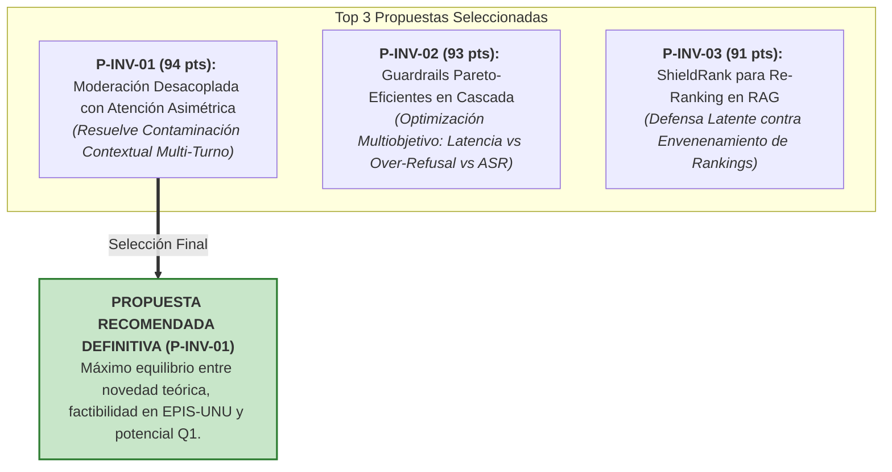

# 🏆 Portafolio de Oportunidades y Ranking Multicriterio

> [!abstract] Metodología de Priorización Científica
> A partir de los vacíos de conocimiento y las contradicciones detectadas en la literatura (2023–2026), se formularon **6 propuestas de investigación científica**. Cada propuesta fue sometida a una matriz de evaluación multicriterio sobre **100 puntos**:
> - **C1: Novedad Teórica y Originalidad** (25 pts)
> - **C2: Rigor y Solidez Metodológica** (20 pts)
> - **C3: Viabilidad Experimental en EPIS-UNU** (20 pts) *(Disponibilidad de GPUs, APIs, modelos abiertos y datasets)*
> - **C4: Potencial de Publicación Q1 / Q2** (20 pts)
> - **C5: Impacto y Relevancia en Producción** (15 pts)

---

## 📊 Matriz Comparativa y Ranking General

| Código | Denominación de la Propuesta | C1 (25) | C2 (20) | C3 (20) | C4 (20) | C5 (15) | Total (100) | Clasificación |
| :---: | :--- | :---: | :---: | :---: | :---: | :---: | :---: | :---: |
| **P-INV-01** | **Moderación Desacoplada con Atención Asimétrica contra Contaminación Contextual Multi-Turno (AAM-Guard)** | **24** | **19** | **18** | **19** | **14** | **94** | 🥇 **Selección Principal** |
| **P-INV-02** | **Framework Pareto-Eficiente para Guardrails en Producción (ParetoGuard)** | 22 | 19 | 20 | 18 | 14 | **93** | 🥈 Alternativa Altamente Viable |
| **P-INV-03** | **ShieldRank: Re-ranking Robusto contra RAG Poisoning en Motores Conversacionales** | 22 | 18 | 19 | 18 | 14 | **91** | 🥉 Alternativa Especializada |
| **P-INV-04** | Arquitectura Honey-LLM de Decepción Activa para Agentes Autónomos | 20 | 17 | 18 | 17 | 14 | **86** | Fase Posterior |
| **P-INV-05** | Purificación Dinámica de Gradientes para Fine-Tuning Seguro en LMaaS | 20 | 17 | 14 | 18 | 13 | **82** | Alta Exigencia de Cómputo |
| **P-INV-06** | Benchmark Unificado de Robustez Empírica y Over-Refusal en Modelos Multimodales | 18 | 16 | 16 | 16 | 13 | **79** | Enfoque Descriptivo |

---

## 🥇 Las Tres Oportunidades de Mayor Impacto (Top 3)

### 1. P-INV-01: Moderación Desacoplada con Atención Asimétrica (94 pts)
- **Problema:** Resuelve directamente el conflicto entre la descontextualización de Santilli (*D-SHIELD*) y la necesidad de historia conversacional ante ataques de jailbreak multi-turno (*Crescendo*).
- **Aporte Original:** Algoritmo *Asymmetric Attention Masking* (AAM) que permite al juez consultar dependencias fácticas del diálogo bloqueando la retórica de manipulación de rol.
- **Ventaja EPIS-UNU:** Puede implementarse completamente sobre Llama-3.1-8B-Instruct en una GPU de 24 GB VRAM (RTX 3090/4090 o instancia AWS g5.xlarge) con benchmarks públicos (Crescendo, XSTest).

### 2. P-INV-02: Framework Pareto-Eficiente para Guardrails en Producción (93 pts)
- **Problema:** Optimización de la frontera de Pareto para resolver el trilema entre latencia (<40 ms), over-refusal (<3%) y ASR en guardrails de producción.
- **Aporte Original:** Enrutamiento adaptativo en cascada bayesiana calibrado mediante algoritmos genéticos multiobjetivo NSGA-II.

### 3. P-INV-03: ShieldRank contra RAG Poisoning (91 pts)
- **Problema:** Los sistemas RAG son vulnerables a la manipulación del ranking de recuperación, donde pasajes maliciosos se posicionan en el Top-1 con >87.5% de éxito.
- **Aporte Original:** Función de puntuación en re-ranking ponderada por divergencia de densidad latente (*Local Outlier Factor* - LOF).

---

## 🎯 Veredicto: Selección de la Tesis de Grado
Se ratifica la adopción formal de **P-INV-01** como el proyecto de tesis para el Ciclo X y titulación profesional en la EPIS-UNU.

---

> [[Contradicciones Científicas y Debates Abiertos|⬅️ Anterior: Contradicciones]] | [[Dashboard Trabajo de Investigación|🏠 Dashboard]] | [[PRJ - Tesis AAM-Guard Atención Asimétrica|➡️ Siguiente: Propuesta Formal AAM-Guard]]
