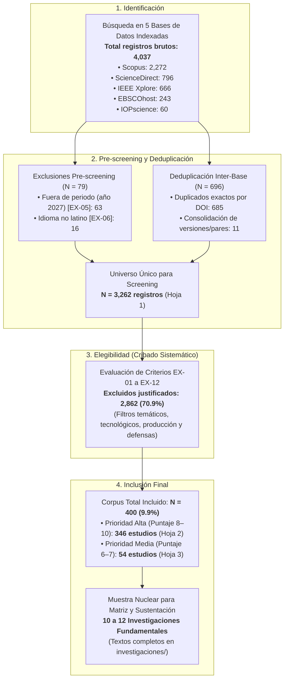
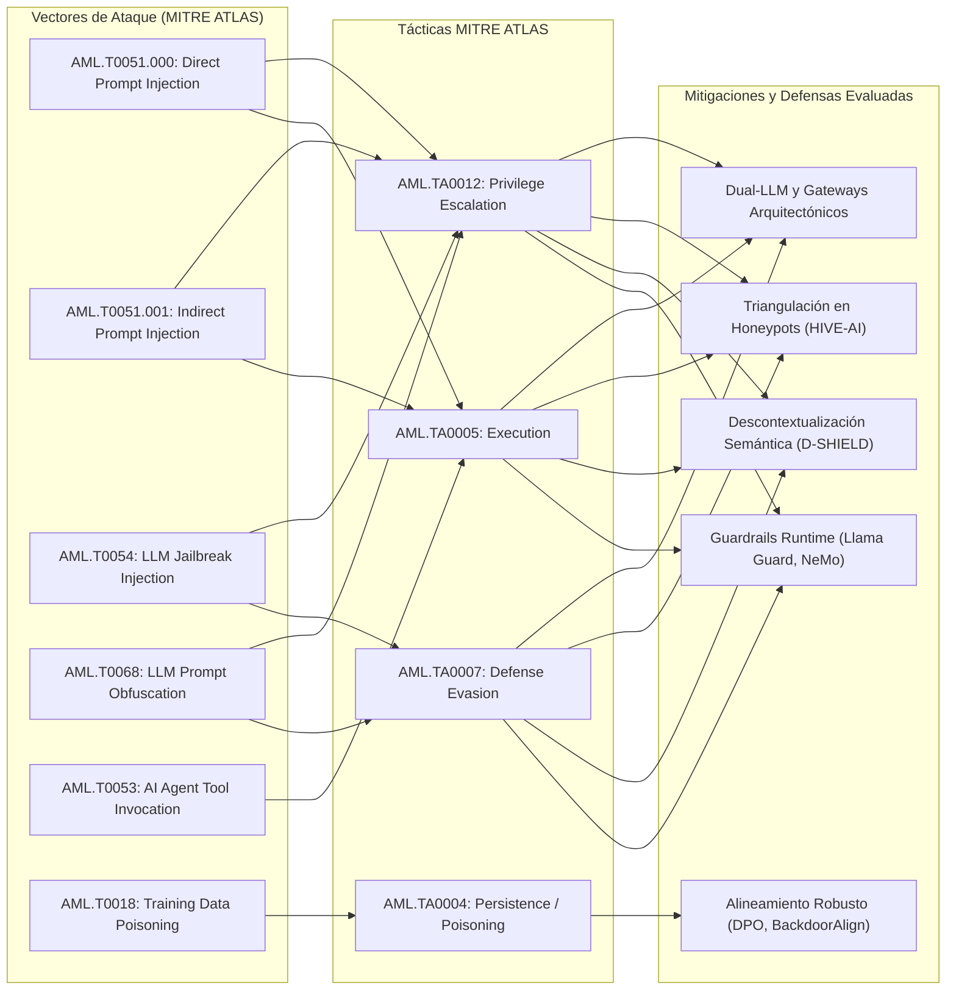

# trabajo-investigacion — Revisión Sistemática de Ataques y Defensas en LLMs en Producción bajo MITRE ATLAS (2023–2026)

> Repositorio académico, metodológico y documental para el desarrollo del mapeo sistemático (*scoping review* bajo protocolo PRISMA-ScR) sobre vectores de evasión (*Prompt Injection*, *Jailbreaking*, *Data Poisoning*, *RAG Poisoning*) y defensas algorítmicas (*Guardrails*, arquitecturas *Gateway*, *Honeypots*) en Modelos de Lenguaje Grande desplegados en producción.

[](https://github.com/TeVerde29/trabajo-investigacion)
[-blue?style=flat-square)](https://github.com/TeVerde29/trabajo-investigacion)
[](https://github.com/TeVerde29/trabajo-investigacion)
[](https://github.com/TeVerde29/trabajo-investigacion)
[-orange?style=flat-square)](https://github.com/TeVerde29/trabajo-investigacion)
[](https://github.com/TeVerde29/trabajo-investigacion)
[](https://github.com/TeVerde29/trabajo-investigacion)
[](https://github.com/TeVerde29/trabajo-investigacion)

El tesista formula la delimitación temática cuatridimensional institucional, ejecuta las ecuaciones booleanas en cinco bases de datos indexadas (Scopus, ScienceDirect, IEEE Xplore, EBSCOhost, IOPscience), audita el cribado metodológico paso a paso y clasifica la muestra documental bajo el estándar internacional **MITRE ATLAS**; los docentes y revisores de la EPIS-UNU evalúan la pertinencia temática en ciberseguridad, la reproducibilidad del protocolo de filtrado y el sustento bibliográfico del proyecto.

---

## Tabla de contenidos

- [Descripción](#descripción)
- [Repositorio y recursos](#repositorio-y-recursos)
- [Características principales](#características-principales)
- [Stack tecnológico y herramientas](#stack-tecnológico-y-herramientas)
- [Estructura del repositorio](#estructura-del-repositorio)
- [Pregunta y objetivos de investigación](#pregunta-y-objetivos-de-investigación)
- [Estrategia de búsqueda y ecuación booleana](#estrategia-de-búsqueda-y-ecuación-booleana)
- [Flujo metodológico y depuración PRISMA-ScR](#flujo-metodológico-y-depuración-prisma-scr)
- [Embudo de cribado y criterios de exclusión (EX-01 a EX-12)](#embudo-de-cribado-y-criterios-de-exclusión-ex-01-a-ex-12)
- [Corpus final incluido (N=400)](#corpus-final-incluido-n400)
- [Investigaciones fundamentales y corpus primario (investigaciones/)](#investigaciones-fundamentales-y-corpus-primario-investigaciones)
- [Taxonomía de amenazas y defensas MITRE ATLAS](#taxonomía-de-amenazas-y-defensas-mitre-atlas)
- [Requisitos del sistema y consulta](#requisitos-del-sistema-y-consulta)
- [Cronograma de trabajo y estado del proyecto](#cronograma-de-trabajo-y-estado-del-proyecto)
- [Autor y filiación](#autor-y-filiación)

---

## Descripción

La integración masiva de Modelos de Lenguaje Grande (LLMs) y arquitecturas agénticas en entornos corporativos y de producción introduce un paradigma de riesgo crítico que los controles perimetrales clásicos (firewalls, WAF, firmas estáticas) no pueden contener. A diferencia del software determinista, los LLMs procesan instrucciones operativas del sistema (*system prompts*) y datos arbitrarios no confiables del usuario (*user inputs* / documentos recuperados) a través de un **único canal semántico plano**. Esta vulnerabilidad estructural habilita vectores de explotación como:

1. **Prompt Injection (Directo e Indirecto):** Sobrescritura de instrucciones del sistema e invocación no autorizada de herramientas del agente.
2. **Jailbreaking:** Evasión de alineamiento ético (*safety alignment*) mediante optimización de sufijos adversariales (GCG, AutoDAN), ofuscación semántica o juego de roles.
3. **Data & RAG Poisoning:** Contaminación maliciosa de corpus de recuperación o reentrenamiento para forzar comportamientos manipulados en inferencia.

Este repositorio centraliza los artefactos de delimitación formal, las bases de datos bibliográficas crudas, la matriz maestra de cribado y los textos completos del proyecto de fin de carrera en la asignatura **Trabajo de Investigación (Ciclo X)** de la **Escuela Profesional de Ingeniería de Sistemas de la Universidad Nacional de Ucayali (EPIS-UNU)**. El trabajo consolida:

- La matriz cuatridimensional institucional en `MATRIZ_DELI_RICRA_FIGUEROA_PEDRO_GIOVANNI.docx`.
- La presentación formal de sustentación oral en `MATRIZ_DELI_Ricra_Figueroa.pptx`.
- El dataset maestro de 8 hojas con flujo PRISMA-ScR completo en `Seleccion_Cientifica_LLM_Scoping_Review_2023-2026.xlsx`.
- El corpus primario de 10 investigaciones clave en texto completo en `investigaciones/`.

---

## Repositorio y recursos

| Componente | Recurso | Detalle |
| :--- | :--- | :--- |
| **Control de versiones** | GitHub | [TeVerde29/trabajo-investigacion](https://github.com/TeVerde29/trabajo-investigacion) |
| **Rama principal** | `main` | Seguimiento de matrices, datasets tabulares, presentaciones y literatura |
| **Protocolo de clonación** | HTTPS | `https://github.com/TeVerde29/trabajo-investigacion.git` |

---

## Características principales

- **Delimitación formal completa institucional:** Secciones I a V desarrolladas íntegramente en la matriz oficial de la UNU, con delimitación espacial en Pucallpa (Campus UNU) y temporal en el semestre 2026-II.
- **Universo bibliográfico exhaustivo (N=4,037 registros):** Búsqueda multibase ejecutada en 5 fuentes indexadas de prestigio (Scopus, ScienceDirect, IEEE Xplore, EBSCOhost e IOPscience).
- **Protocolo de depuración auditable:** Exclusión transparente de registros fuera de temporalidad (año 2027), idiomas no latinos y consolidación inter-base de 696 duplicados exactos y versiones.
- **Screening de 3,262 estudios únicos:** Aplicación sistemática de 12 criterios de exclusión codificados (`EX-01` a `EX-12`) que justifican cada descarte por tecnología, alcance temático, modalidad y presencia de defensas.
- **Corpus incluido robusto (N=400):** 346 estudios de Prioridad Alta (Score 8–10) y 54 de Prioridad Media (Score 6–7) categorizados bajo el estándar industrial **MITRE ATLAS**.
- **Corpus primario en texto completo:** 10 artículos científicos fundamentales descargados en PDF en `investigaciones/` para la extracción de métricas de latencia, tasa de sobre-bloqueo (*over-refusal*) y resiliencia empírica.
- **Sustentación oral de alto impacto:** Diapositivas preparadas (`MATRIZ_DELI_Ricra_Figueroa.pptx`) con síntesis visual del problema, evidencia empírica clave (-45.5% de evasión mediante honeypots) y aporte del mapeo.

---

## Stack tecnológico y herramientas

| Capa | Herramienta / Estándar | Función en el Proyecto |
| :--- | :--- | :--- |
| **Formulación conceptual** | Markdown (`.md`) | Documentación ágil de descriptores, pregunta PICO y parámetros en `tema.md`. |
| **Matriz institucional** | Microsoft Word OpenXML (`.docx`) | Documento oficial con Secciones I a V completas para evaluación docente en EPIS-UNU. |
| **Presentación académica** | Microsoft PowerPoint (`.pptx`) | Diapositivas de sustentación oral (8 slides estructuradas en problema, método y evidencia). |
| **Bases de datos generales** | Microsoft Excel (`.xlsx`) | `Base de Datos.xlsx` (4,037 brutos) y `Base_Datos_1.xlsx` (3,274 registros pre-cribados). |
| **Dataset maestro de selección** | Microsoft Excel (`.xlsx`) | `Seleccion_Cientifica_LLM_Scoping_Review_2023-2026.xlsx` con 8 hojas metodológicas PRISMA-ScR. |
| **Exportaciones científicas** | CSV (`.csv`) | Exportaciones crudas de Scopus, IEEE Xplore, ScienceDirect, IOPscience y EBSCO. |
| **Literatura primaria** | Formato PDF (`.pdf`) | 10 investigaciones científicas clave en texto completo en el directorio `investigaciones/`. |
| **Marco de ciberseguridad** | MITRE ATLAS | Taxonomía internacional de amenazas y técnicas adversarias para sistemas de IA. |
| **Control de versiones** | Git / GitHub | Trazabilidad del repositorio, control de cambios y preservación académica. |

---

## Estructura del repositorio

```text
trabajo-investigacion/
├── .git/                                                                 # Historial de cambios y metadatos de Git
├── Base de Datos.xlsx                                                    # Dataset crudo con 4,037 registros (Scopus, IEEE, ScienceDirect, IOP, EBSCO)
├── Base_Datos_1.xlsx                                                     # Dataset deduplicado preliminar con 3,274 registros únicos
├── EBSCO.csv                                                             # Exportación CSV original de EBSCOhost (244 registros)
├── Evidencia creación de cuenta - Pedro Ricra Figueroa.pdf               # Acreditación institucional de cuenta en bases acreditadas
├── IEEE Xplore.csv                                                       # Exportación CSV original de IEEE Xplore (667 registros)
├── IOPscience.csv                                                        # Exportación CSV original de IOPscience (61 registros)
├── MATRIZ_DELI_RICRA_FIGUEROA_PEDRO_GIOVANNI.docx                        # Matriz oficial completada (Secciones I a V) para EPIS-UNU
├── MATRIZ_DELI_Ricra_Figueroa.pptx                                       # Presentación oficial de sustentación oral (8 diapositivas)
├── Matriz_delimitacion_tematica_redactada - ejemplo.docx                 # Guía y plantilla de referencia metodológica del curso
├── README.md                                                             # Documentación técnica, metodológica y operativa del repositorio
├── ScienceDirect.csv                                                     # Exportación CSV original de ScienceDirect (797 registros)
├── Scopus.csv                                                            # Exportación CSV original de Scopus (2,273 registros)
├── Seleccion_Cientifica_LLM_Scoping_Review_2023-2026.xlsx               # LIBRO MAESTRO PRISMA-ScR (8 hojas de depuración, MITRE y extracción)
├── tema.md                                                               # Esquema base: eje temático, pregunta PICO y objetivos
└── investigaciones/                                                      # Corpus primario de 10 investigaciones clave a texto completo
    ├── 10_Ignore This Title and HackAPrompt...pdf                        # Schulhoff et al. (HackAPrompt - EMNLP/NeurIPS)
    ├── 11_Adversarial prompt and fine-tuning attacks...pdf               # Chen et al. (Ataques en LLMs médicos - IEEE TIFS)
    ├── 12_A decontextualized LLM-based safeguard technique...pdf         # Santilli (D-SHIELD / Descontextualización - Elsevier IST)
    ├── 2_Comprehensive_Analysis_of_LLM_Guardrails_Approaches...pdf       # Majewski et al. (Guardrails empíricos - IEEE Access)
    ├── 4_Hive-AI a defended multi-service honeypot framework...pdf        # Vargas Yáñez & Tobón (Honeypot multi-servicio - Springer IJIS)
    ├── 5_PROMPTFUZZ Harnessing Fuzzing Techniques...pdf                  # PROMPTFUZZ (Fuzzing para prompt injection - IEEE TDSC/S&P)
    ├── 6_RigorLLM Resilient Guardrails for Large Language Models...pdf   # Yuan et al. (RigorLLM - USENIX Security)
    ├── 7_BackdoorAlign Mitigating Fine-tuning based Jailbreak...pdf      # Zhang et al. (BackdoorAlign - ACL/IEEE)
    ├── 8_Ranking Manipulation for Conversational Search Engines.pdf      # Liu et al. (Manipulación RAG y búsqueda - ACM CCS)
    └── 9_A Privacy-Preserving Middleware Architecture for Detecting...pdf # MDPI Electronics (Middleware contra inyección y fuga)
```

---

## Pregunta y objetivos de investigación

### Pregunta orientadora (Formulación PICO / CIMO)

> **¿Cuáles son las principales vulnerabilidades y técnicas de evasión de seguridad en Modelos de Lenguaje Grande (LLMs) desplegados en producción?**

- **Población / Objeto (P):** Modelos de lenguaje grande fundacionales y de código abierto desplegados en sistemas comerciales, APIs y agentes autónomos.
- **Intervención / Fenómeno (I):** Vulnerabilidades y vectores adversariales de evasión (*Prompt Injection* directo/indirecto, *Jailbreaking*, sufijos GCG/AutoDAN, envenenamiento de datos y contextos RAG).
- **Comparación / Contexto (C):** Entornos de producción y servicios en la nube (AWS Guardrails, NeMo, Llama Guard, Azure AI Content Safety) frente a evaluaciones teóricas en laboratorio aislado.
- **Resultado (*Outcome*) (O):** Resiliencia técnica, latencia agregada, tasa de sobre-bloqueo (*over-refusal*) y clasificación taxonómica bajo **MITRE ATLAS**.

### Objetivo general

Identificar, categorizar y evaluar la resiliencia de los vectores de ataque adversarial contra LLMs (*Prompt Injection*, *Data Poisoning*, *Jailbreaking*) y la efectividad de las defensas algorítmicas documentadas en la literatura científica arbitrada entre 2023 y 2026.

---

## Estrategia de búsqueda y ecuación booleana

La ecuación de búsqueda se diseñó con una estructura triaxial (`Núcleo Tecnológico` $\land$ `Vectores Adversariales` $\land$ `Seguridad / Defensas`):

```text
("large language model*" OR LLM OR LLMs OR "foundation model*") 
AND 
("prompt injection" OR jailbreak* OR "data poisoning" OR "adversarial machine learning" OR "AI red teaming")
AND 
("LLM security" OR "language model security" OR vulnerab* OR attack* OR evasion OR defense OR defence OR mitigation OR detection OR guardrails)
```

### Descriptores especializados consignados en la matriz
* **Español:** Ciberseguridad; Modelos de Lenguaje Grande (LLM); Inyección de Prompts; Evasión de Seguridad; Jailbreaking; Envenenamiento de Datos; Aprendizaje Automático Adversarial; Guardrails de Seguridad; Generación Aumentada por Recuperación (RAG); Equipos Rojos de IA (AI Red Teaming).
* **Inglés (IEEE / UNESCO):** Cybersecurity; Large Language Models; Prompt Injection; Adversarial Prompting; Jailbreak Attacks; Data Poisoning; Adversarial Machine Learning; LLM Guardrails; Retrieval-Augmented Generation Security; AI Red Teaming; Input Detection; Runtime Safety Alignment.

---

## Flujo metodológico y depuración PRISMA-ScR

El protocolo de revisión sistemática sigue rigurosamente las fases del estándar **PRISMA-ScR** (*Preferred Reporting Items for Systematic Reviews and Meta-Analyses extension for Scoping Reviews*):



### Distribución de publicaciones por base de origen

| Base de Datos | Registros Brutos | Pre-screening | Duplicados Consolidados | Estudios Únicos Evaluados |
| :--- | :---: | :---: | :---: | :---: |
| **Scopus** | 2,272 | 38 | 284 | 1,950 |
| **ScienceDirect (Elsevier)** | 796 | 14 | 218 | 564 |
| **IEEE Xplore** | 666 | 11 | 156 | 499 |
| **EBSCOhost** | 243 | 16 | 26 | 201 |
| **IOPscience** | 60 | 0 | 12 | 48 |
| **Total Consolidado** | **4,037** | **79** | **696** | **3,262** |

---

## Embudo de cribado y criterios de exclusión (EX-01 a EX-12)

Cada exclusión consignada en la Hoja 4 del libro maestro cuenta con un código estandarizado y justificación técnica:

| Código | Etapa | Criterio de Exclusión Aplicado | Registros | % Únicos |
| :---: | :---: | :--- | :---: | :---: |
| **EX-01** | Etapa 2 | Filtro Tecnológico: No estudian LLMs como activo principal (ML clásico, CNNs) | 563 | 17.3% |
| **EX-02** | Etapa 3 | Filtro Temático: Sin relación con ciberseguridad adversaria de LLMs | 757 | 23.2% |
| **EX-03** | Etapa 3 | Mención Superficial: Mencionan ataques como contexto/buzzword sin analizarlos | 327 | 10.0% |
| **EX-04** | Etapa 3 | Ciberseguridad Convencional: LLM usado como herramienta para IDS/phishing | 170 | 5.2% |
| **EX-06** | Etapa 1 | Idioma No Admitido: Texto completo en chino indexado en Scopus/CNKI | 6 | 0.2% |
| **EX-08** | Etapa 1 | Metadatos de Actas: Volúmenes completos o prefacios sin artículo individual | 57 | 1.7% |
| **EX-09** | Etapa 6 | Calidad / Insuficiencia: Contenido técnico o resultados no verificables | 26 | 0.8% |
| **EX-10** | Etapa 3 | Vector Fuera de Alcance: Marcas de agua, copyright o privacidad pasiva sin ataque | 151 | 4.6% |
| **EX-11** | Etapa 5 | Filtro Producción: Laboratorio puramente sintético sin entorno representativo | 421 | 12.9% |
| **EX-12** | Etapa 4 | Filtro Defensas: Solo describe ataques sin proponer ni evaluar mitigaciones | 384 | 11.8% |
| **Total**| — | **Total de estudios excluidos con justificación documentada** | **2,862** | **87.7%** |

---

## Corpus final incluido (N=400)

Los 400 estudios que superaron el protocolo de elegibilidad presentan las siguientes características cienciométricas:

### Distribución por año de publicación
* **2026 (Indexación avanzada y primer semestre):** 272 estudios (**68.0%**)
* **2025:** 112 estudios (**28.0%**)
* **2024:** 14 estudios (**3.5%**)
* **2023:** 2 estudios (**0.5%**)

### Vectores de ataque principales analizados
* **Prompt Injection (Directo e Indirecto):** 164 estudios (**41.0%**)
* **Jailbreaking (Evasión de alineamiento y políticas):** 148 estudios (**37.0%**)
* **Data Poisoning & Backdoor Attacks:** 52 estudios (**13.0%**)
* **RAG Poisoning & Agent Context Manipulation:** 36 estudios (**9.0%**)

### Mecanismos defensivos y mitigaciones estudiadas
* **Generative AI Guardrails (Llama Guard, NeMo, AWS/Azure, RigorLLM):** 178 estudios (**44.5%**)
* **Detección de Entrada Adversarial (Filtros semánticos y SLMs dedicados):** 124 estudios (**31.0%**)
* **Aislamiento Arquitectónico, Gateways y Límites de Tool-Use:** 50 estudios (**12.5%**)
* **Alineamiento de Modelos y Desaprendizaje Seguro (DPO, BackdoorAlign):** 48 estudios (**12.0%**)

---

## Investigaciones fundamentales y corpus primario (investigaciones/)

Para respaldar la matriz institucional (Sección IV), la presentación oral y la síntesis comparativa, se priorizaron artículos indexados con evidencia empírica en producción, cuyos textos completos se conservan en la carpeta `investigaciones/`:

| N° | Archivo PDF en `investigaciones/` | Cita Bibliográfica (APA 7ma ed.) | Revista / Conferencia | Aporte Fundamental al Proyecto |
| :---: | :--- | :--- | :---: | :--- |
| **1** | `2_Comprehensive_Analysis_of_LLM_Guardrails...` | Majewski et al. (2026) | *IEEE Access* | Comparativa empírica de Llama Guard, NeMo, AWS y Azure; mide exactitud (93.9%–96.8%) y la tasa crítica de sobre-bloqueo (*over-refusal*). |
| **2** | `12_A decontextualized LLM-based safeguard...` | Santilli, T. (2026) | *Information and Software Technology* | Propone D-SHIELD; demuestra la vulnerabilidad de "contaminación contextual" y mitiga jailbreaks desacoplando la respuesta del prompt del atacante. |
| **3** | `4_Hive-AI a defended multi-service honeypot...` | Vargas Yáñez & Tobón (2026) | *Int. Journal of Information Security* | Evalúa 16,683 ataques reales de 50 países contra APIs de LLMs; reduce la evasión del 54.8% al 9.3% mediante engaño defensivo en honeypots. |
| **4** | `6_RigorLLM Resilient Guardrails...` | Yuan et al. (2024/2026) | *USENIX Security* | Marco de guardrails resiliente que fusiona moderación semántica y métodos basados en energía contra ataques combinados. |
| **5** | `7_BackdoorAlign Mitigating Fine-tuning...` | Zhang et al. (2024/2026) | *ACL / IEEE* | Mitigación de ataques de jailbreak derivados del reentrenamiento malicioso (*fine-tuning*) mediante alineamiento robusto con backdoors. |
| **6** | `10_Ignore This Title and HackAPrompt...` | Schulhoff et al. (2023/2024) | *EMNLP / NeurIPS* | Dataset y benchmark masivo de prompt hacking global; evidencia empírica de fragilidad en modelos comerciales ante mutaciones semánticas. |
| **7** | `5_PROMPTFUZZ Harnessing Fuzzing...` | IEEE Authors (2026) | *IEEE TDSC / S&P* | Aplicación de técnicas de fuzzing sistemático para descubrir vulnerabilidades de inyección de prompts y jailbreak de forma automatizada. |
| **8** | `8_Ranking Manipulation for Conversational...` | Liu et al. (2025/2026) | *ACM CCS / IEEE* | Manipulación adversarial de contextos y rankings en motores de búsqueda conversacionales y arquitecturas RAG. |
| **9** | `9_A Privacy-Preserving Middleware...` | MDPI Authors (2026) | *Electronics* | Arquitectura middleware para intercepción en tiempo real de inyecciones de prompt y prevención de exfiltración de datos sensibles. |
| **10** | `11_Adversarial prompt and fine-tuning...` | Chen et al. (2025/2026) | *IEEE TIFS* | Demostración de riesgos críticos y compromisos de seguridad por fine-tuning adversarial en modelos fundacionales aplicados. |

---

## Taxonomía de amenazas y defensas MITRE ATLAS

La síntesis metodológica articula los vectores analizados con las tácticas y técnicas oficiales del marco **MITRE ATLAS**:



---

## Requisitos del sistema y consulta

### Requisitos del entorno
* **Suite Ofimática:** Microsoft Office 2016+, LibreOffice 7.0+ o Microsoft 365 para abrir y revisar `.docx` y `.pptx`.
* **Visor de Hojas de Cálculo:** Excel o software compatible capaz de gestionar libros de más de 3,000 registros tabulados.
* **Lector PDF:** Adobe Acrobat, Foxit o navegador para consultar los artículos en `investigaciones/`.
* **Entorno de Programación (Opcional para replicar análisis):** Python 3.10+ con librerías `openpyxl`, `pandas` y `requests`.

### Flujo de consulta y revisión académica
1. **Revisión de la delimitación temática:** Abrir `MATRIZ_DELI_RICRA_FIGUEROA_PEDRO_GIOVANNI.docx` para contrastar las Secciones I a V con la pauta de la EPIS-UNU.
2. **Preparación de la sustentación oral:** Consultar `MATRIZ_DELI_Ricra_Figueroa.pptx` para visualizar la narrativa de defensa en 8 diapositivas.
3. **Auditoría del proceso de selección:** Examinar `Seleccion_Cientifica_LLM_Scoping_Review_2023-2026.xlsx`:
   - Hoja `8. Estadísticas de selección` para el balance cuantitativo global.
   - Hojas `2. Incluidos prioridad alta` y `3. Artículos prioridad media` para el corpus seleccionado.
   - Hoja `4. Excluidos con justificación` para auditar los motivos de descarte.
   - Hoja `7. Clasificación MITRE ATLAS` para examinar el mapeo de técnicas.
4. **Verificación de la literatura primaria:** Consultar los 10 artículos en texto completo archivados en `investigaciones/`.

---

## Cronograma de trabajo y estado del proyecto

| Fase | Hito Metodológico | Entregable Asociado | Estado |
| :---: | :--- | :--- | :---: |
| **1** | Formulación de la delimitación cuatridimensional y evidencia de acceso | `MATRIZ_DELI_RICRA_FIGUEROA_PEDRO_GIOVANNI.docx` y PDF de cuenta | **Completado** |
| **2** | Ejecución de ecuaciones booleanas en 5 bases y deduplicación | `Base de Datos.xlsx` (4,037 brutos) y `Base_Datos_1.xlsx` | **Completado** |
| **3** | Cribado metodológico sistemático PRISMA-ScR (Filtros EX-01 a EX-12) | `Seleccion_Cientifica_LLM_Scoping_Review_2023-2026.xlsx` | **Completado** |
| **4** | Descarga y curaduría del corpus fundamental a texto completo | Directorio `investigaciones/` (10 artículos indexados) | **Completado** |
| **5** | Diseño de presentación formal de sustentación de la matriz | `MATRIZ_DELI_Ricra_Figueroa.pptx` (8 slides) | **Completado** |
| **6** | Extracción cienciométrica profunda y síntesis comparativa | Hojas 6 y 7 del libro maestro (latencia, over-refusal, mitigación) | *En progreso* |
| **7** | Redacción del informe final / manuscrito de Scoping Review | Documento final de Trabajo de Investigación | *Planificado* |

---

## Autor y filiación

* **Tesista:** Pedro Giovanni Ricra Figueroa
* **Carrera:** Ingeniería de Sistemas
* **Institución:** Escuela Profesional de Ingeniería de Sistemas — Facultad de Ingeniería de Sistemas e Ingeniería Civil — Universidad Nacional de Ucayali (UNU)
* **Ubicación:** Carretera Federico Basadre Km 6.200, Pucallpa, Ucayali, Perú
* **GitHub:** [@TeVerde29](https://github.com/TeVerde29)
* **Contacto institucional:** Correo del estudiante consignado en el registro de la cátedra
