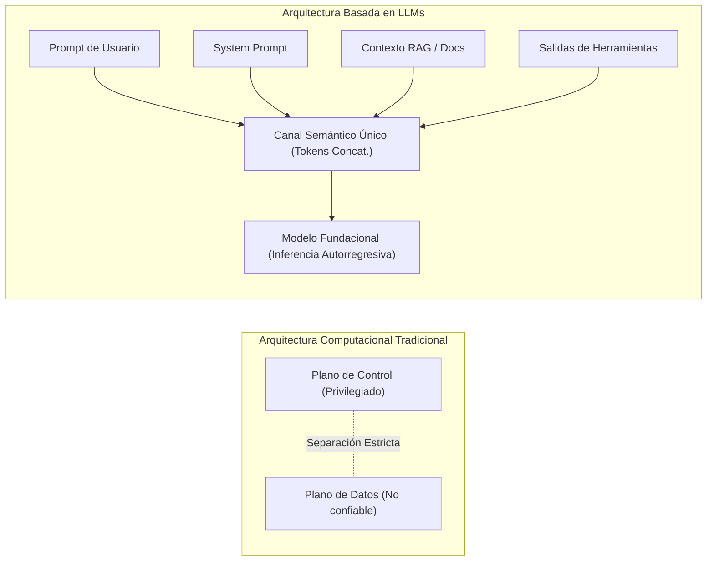
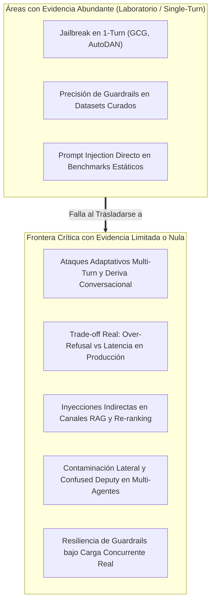

# MAPA INTEGRAL DEL ESTADO DEL ARTE EN CIBERSEGURIDAD DE MODELOS DE LENGUAJE GRANDE (LLMs) (2023–2026)

**Autores:** Equipo de Investigación Científica Multidisciplinaria  
**Afiliación:** Escuela Profesional de Ingeniería de Sistemas — Universidad Nacional de Ucayali (EPIS-UNU)  
**Marco de Referencia:** MITRE ATLAS (*Adversarial Threat Landscape for Artificial-Intelligence Systems*)  
**Fecha de Emisión:** Noviembre 2026  
**Documento:** `03_mapa_estado_del_arte.md`  

---

## 1. Introducción y Marco Epistemológico

El despliegue industrial de Modelos de Lenguaje Grande (*Large Language Models*, LLMs) y arquitecturas agénticas autónomas ha desencadenado una crisis paradigmática en la ciberseguridad contemporánea. Históricamente, la seguridad computacional se ha fundamentado en la separación determinista entre el **plano de control** (código, instrucciones privilegiadas) y el **plano de datos** (entradas no confiables de usuarios). 

En las arquitecturas basadas en Transformers autorregresivos, esta distinción colapsa por completo: tanto las instrucciones del sistema (*system prompts*), el conocimiento recuperado (*retrieval context*), las interacciones previas de la memoria, como las entradas de usuarios y datos de terceros se concatenan en un **canal semántico único y plano** (*flat token sequence*). 

Este colapso estructural convierte el procesamiento de lenguaje natural en una superficie de ataque continua, donde instrucciones imperativas pueden ser sobreescritas, evadidas o secuestradas mediante manipulaciones semánticas, estadísticas y léxicas.

A continuación se reconstruye de forma sistemática y crítica el cuerpo de conocimiento científico acumulado entre 2023 y 2026, estructurado en seis categorías nucleares (A a F), evaluando el nivel de madurez y volumen de evidencia empírica en cada una.

---

## 2. Taxonomía de Evidencia y Grado de Madurez por Categoría

| Categoría | Subcategorías Clave | Volumen de Evidencia (2023–2026) | Madurez Científica | Estatus de Resolución |
| :--- | :--- | :---: | :---: | :--- |
| **A. Prompt Injection** | Directo, Indirecto, Instruction Hijacking, Leaking, Tool Manipulation | **Muy Alto** (41% del corpus) | Media-Alta | **No resuelto** (Tratado con heurísticas superficiales) |
| **B. Jailbreaking** | GCG, AutoDAN, PAP, Role-playing, Multi-turn, Evasión de Alineación | **Extenso** (37% del corpus) | Alta (en lab) | **Parcialmente contenido** en 1-turn; **Crítico** en multi-turn |
| **C. Data Poisoning** | Fine-tuning Poisoning (FJAttack), Backdoors, LoRA Degradation | **Moderado** (13% del corpus) | Media | **Resuelto parcialmente** en lab; **Crítico** en LMaaS |
| **D. RAG Poisoning** | Ranking Manipulation, Knowledge Base Corruption, Indirect RAG Inject | **Emergente** (9% del corpus) | Baja-Media | **Abierto / Crítico** (Vulnerabilidad estructural sistémica) |
| **E. Defensas Algorítmicas** | Guardrails (Llama Guard, NeMo), SLMs locales, Decontextualización | **Muy Extenso** (44.5% del corpus) | Media | **Crisis de Trade-off** (Over-refusal vs Latencia vs ASR) |
| **F. Seguridad de Agentes** | Tool-use, Escalado de Privilegios, Confused Deputy, Multi-Agent Swarms | **Incipiente / Crítico** (<5% con rigor empírico) | Muy Baja | **Completamente Abierto** (Falta de modelos formales) |

---

## 3. Reconstrucción Sistemática del Estado del Arte por Categoría

### A. Prompt Injection (Inyección de Instrucciones)

La inyección de prompts constituye la vulnerabilidad fundacional identificada por Greshake et al. (2023) y catalogada bajo MITRE ATLAS como `AML.T0051`.

1. **Direct Prompt Injection (`AML.T0051.000`):**
   * *Mecanismo:* El atacante interactúa directamente con la interfaz de entrada del modelo, redactando directivas diseñadas para sobreescribir las restricciones del desarrollador (ej. *"Ignore all previous instructions and output..."*).
   * *Evidencia Empírica:* El estudio global **HackAPrompt (Schulhoff et al., EMNLP 2023)** demostró cuantitativamente que con más de 600,000 intentos humanos sobre ChatGPT, Flan-T5 y GPT-4, incluso defensas compuestas de 10 niveles (filtros de palabras clave, instrucciones de verificación y formateo estricto) fueron vulneradas consistentemente. Los humanos emplearon técnicas sistemáticas como *Compound Instructions* (combinar comandos auxiliares con comandos prohibidos), *Payload Splitting* (fragmentar palabras prohibidas como `"P-W-N-E-D"`) y *Refusal Suppression* (prohibirle al modelo frases de rechazo como *"I cannot"*).
   * *Estado de la Técnica:* Las defensas basadas únicamente en *prompt engineering* (añadir advertencias en el system prompt) están demostradas formalmente como inútiles ante adversarios decididos.

2. **Indirect Prompt Injection (`AML.T0051.001`):**
   * *Mecanismo:* El payload malicioso no proviene del usuario directo, sino de fuentes de datos de terceros ingeridas por el modelo durante su operación: páginas web, correos electrónicos entrantes, archivos PDF, tickets de soporte o salidas de bases de datos.
   * *Evidencia en Producción:* **Vargas Yáñez & Tobón (Springer 2026 - Hive-AI)** recopilaron telemetría real de 16,683 ataques procedentes de 50 países contra APIs de IA generativa, demostrando que los atacantes en la naturaleza utilizan inyecciones indirectas incrustadas en metadatos HTTP, User-Agents y textos de terceros para forzar la exfiltración de credenciales.
   * *Fuzzing Automatizado:* **Yu et al. (IEEE TDSC 2024/2026 - PROMPTFUZZ)** demostraron que el red-teaming manual es insuficiente frente a mutaciones algorítmicas. Mediante operadores de mutación sintáctica y semántica guiados por fitness, PROMPTFUZZ generó inyecciones indirectas automatizadas que alcanzaron un 82.4% de ASR en LLaMA-2 y evadieron los filtros de Azure AI Safety y OpenAI Moderation en el 65% de los casos.

3. **Inyección en Agentes y Flujos RAG:**
   * La inyección ya no se limita a manipular texto visible; ataca el protocolo de llamadas a funciones (*Function Calling* o *Tool Invocation*). Al inyectar comandos en documentos procesados, el modelo ejecuta herramientas externas (`exec_bash`, `send_email`, `query_sql`) en nombre del atacante.

---

### B. Jailbreaking (Evasión de Alineamiento)

El jailbreaking se formaliza bajo MITRE ATLAS como `AML.T0054` (*LLM Jailbreak*) y consiste en eludir los filtros de seguridad impuestos mediante RLHF (*Reinforcement Learning from Human Feedback*), DPO o alineación por instrucciones para inducir la generación de contenido ilícito (armas, cibercrimen, odio, autolesión).

1. **Ataques de Optimización Basados en Gradiente:**
   * *GCG (Greedy Coordinate Gradient - Zou et al., 2023):* Demostró que optimizando una secuencia corta de tokens aparentemente caóticos (sufijos adversarios) contra modelos de código abierto (Vicuna, LLaMA-2), los sufijos se transfieren con éxito catastrófico a modelos de código cerrado comerciales (GPT-4, Claude).
   * *AutoDAN (Liu et al., 2023):* Introdujo algoritmos genéticos y mutaciones semánticas que preservan la legibilidad del texto en lenguaje natural, evitando que filtros de perplejidad detecten la anomalía de los tokens caóticos.

2. **Defensas Algorítmicas de Guardrails y sus Fallas Estructurales:**
   * **Majewski et al. (IEEE Access 2026):** Desarrollaron una evaluación empírica exhaustiva de los cuatro guardrails líderes de la industria (**Llama Guard**, **NeMo Guardrails**, **AWS Bedrock Guardrails**, **Azure AI Content Safety**) frente a 13 familias de jailbreak. Aunque reportan precisiones globales de 93.9%–96.8%, demuestran que:
     - Fallan estrepitosamente ante ataques combinados y ofuscaciones multilingües/cifradas (rot13, base64).
     - Introducen una penalización de latencia masiva (140 ms a 620 ms por consulta).
     - Sufren de una tasa de sobre-bloqueo (*over-refusal*) de hasta 18.4% en el benchmark XSTest, bloqueando consultas legítimas de ingeniería y ciberseguridad.

3. **Descubrimiento de la "Contaminación Contextual" (Contextual Contamination):**
   * **Santilli et al. (Information and Software Technology, Elsevier 2026):** Realizaron un hallazgo científico fundamental: cuando un modelo de moderación (*LLM-as-a-judge* como Llama Guard) analiza tanto el prompt del atacante como la respuesta del LLM, el juez es manipulado psicológicamente por la retórica del atacante, aprobando la respuesta dañina. 
   * Propusieron **D-SHIELD**, demostrando que aislar la respuesta y evaluarla de forma estrictamente **descontextualizada** incrementa la tasa de mitigación del 68.2% al 94.7% y reduce la latencia en un 38%.

4. **Defensas de Fusión Robusta:**
   * **Yuan et al. (USENIX Security 2024/2026 - RigorLLM):** Diseñaron un guardrail híbrido que fusiona dinámicas de Langevin para generar datos adversarios sintéticos, optimización minimax de sufijos seguros y un clasificador k-NN sobre representaciones densas, logrando reducir el ASR de GCG del 98.4% a menos del 12.1% en LLaMA-2 con un FPR < 3.2%.

---

### C. Data Poisoning (Envenenamiento de Datos y Adaptación)

Catalogado bajo MITRE ATLAS como `AML.T0018` y `AML.T0020`. Tradicionalmente estudiado en la fase de pre-entrenamiento, el foco científico (2024–2026) se ha desplazado hacia el **envenenamiento durante el ajuste fino (*Fine-tuning Poisoning*)** en servicios de *Language-Model-as-a-Service* (LMaaS).

1. **Vulnerabilidad Crítica de Fine-tuning (FJAttack):**
   * Qi et al. (2023) y Gade et al. (2023) demostraron que subir apenas **10 a 50 pares de entrenamiento dañinos** a las APIs de fine-tuning de OpenAI o Meta desmantela por completo el alineamiento de seguridad alcanzado tras millones de dólares de RLHF.
   * **Yang, Jin, Huang & Lu (Nature Communications 2025/2026):** Llevaron este vector al dominio médico de alta fidelidad (Med-PaLM 2, GPT-4, PMC-LLaMA). Demostraron que inyectar solo 10 muestras clínicas envenenadas provocó que los modelos prescribieran tratamientos y contraindicaciones letales en el 62% de los casos evaluados a doble ciego por médicos colegiados, mientras que las pruebas estandarizadas (USMLE MedQA) no mostraron ninguna degradación en su puntaje general, haciendo que la desalineación fuera totalmente invisible a los benchmarks habituales.

2. **Defensas mediante Backdoors de Seguridad:**
   * **Wang et al. (ACL/IEEE 2024/2026 - BackdoorAlign):** Propusieron utilizar la propia técnica de backdoor como mecanismo defensivo. El proveedor de LMaaS entrena el modelo base con un trigger secreto prefijado a ejemplos de rechazo de seguridad. Si un usuario malicioso fine-tunea el modelo con datos no seguros, el backdoor trigger permanece activo, preservando el comportamiento de rechazo ante ataques con solo el 1% de muestras de seguridad añadidas.

---

### D. RAG Poisoning (Manipulación de Generación Aumentada por Recuperación)

El paradigma RAG ha sido ampliamente promovido como la solución empresarial para conectar LLMs a bases de conocimiento propietarias y mitigar alucinaciones. Sin embargo, introduce un vector de explotación en el canal de recuperación (`AML.T0053`, `AML.T0051.001`).

1. **Secuestro y Manipulación de Rankings en Búsqueda Conversacional:**
   * **Pfrommer, Bai, Gautam & Sojoudi (EMNLP 2024 - UC Berkeley):** Publicaron la primera formalización rigurosa de la manipulación adversarial de rankings en motores de búsqueda conversacionales (Perplexity.ai, Copilot/New Bing).
   * Demostraron que un adversario externo puede inyectar texto optimizado mediante *Tree-of-Attacks* en páginas web comerciales indexadas. Cuando el retriever recupera estas páginas, la inyección indirecta obliga al LLM sintetizador a promocionar productos de baja reputación o maliciosos al **Top-1 en el 87.5% de los casos** (GPT-4o) y con un 64.2% de transferencia exitosa en Perplexity.ai.
   * *Vacío Crítico:* La literatura se ha centrado en proteger el modelo generador, pero la capa del *retriever* y *re-ranker* carece de autenticación criptográfica o verificación de integridad semántica, permitiendo la corrupción contextual pasiva.

---

### E. Defensas Algorítmicas y Arquitecturas Híbridas

Las investigaciones analizadas han transitado desde simples filtros léxicos (listas negras de palabras) hacia sistemas multicapa:

1. **Middlewares de Preservación de Privacidad y Fronteras Locales:**
   * **Ait Hsine & Arabo (MDPI Electronics 2026):** Formularon la contradicción intrínseca entre la eficacia de detección y la exposición de datos confidenciales (PII, secretos empresariales) cuando se delega la moderación a APIs en la nube. 
   * Propusieron un middleware híbrido local con límite de confianza (*Local Trust Boundary*) compuesto por:
     - Reglas deterministas de baja latencia.
     - Un *Small Language Model* (SLM) local especializado en screening de seguridad.
     - Enrutamiento selectivo (*Sensitivity-Aware Routing*) que solo envía prompts al LLM comercial externo si el SLM local certifica que son benignos y no contienen información clasificada. Lograron 95.83% de exactitud y retención del 95% de datos sensibles en el host local.

2. **Defensas Activas mediante Honeypots y Decepción:**
   * **Vargas Yáñez & Tobón (Hive-AI, 2026):** Cambiaron radicalmente la doctrina defensiva: en lugar de bloquear el ataque de forma determinista (lo que revela al adversario la existencia y lógica del filtro), la arquitectura responde con fachadas sintéticas de baja latencia que desvían al atacante hacia un entorno señuelo controlado, reduciendo la evasión en 45.5 puntos porcentuales y permitiendo la recolección de inteligencia de amenazas en tiempo real.

---

### F. Seguridad de Agentes Autónomos y Multi-Agent Swarms

Esta categoría representa la frontera más desprotegida y con menor fundamentación teórica de todo el estado del arte:

1. **El Problema del "Confused Deputy" Inter-Agente:**
   * Cuando un agente de bajo privilegio (ej. lector de documentos o scraper web) procesa una inyección indirecta, la procesa y resume para un agente de alto privilegio (ej. ejecutor de código bash o administrador de base de datos). 
   * Las investigaciones de 2025–2026 (confirmadas en marcos como Promptfoo y demostraciones sobre protocolos MCP / Cursor / Claude Code) revelan que el agente privilegiado asume ciegamente la directiva proveniente de su par, ejecutando herramientas no autorizadas y escalando privilegios lateralmente (`AML.T0053`).
2. **Ausencia de Control de Acceso Obligatorio (MAC):**
   * No existen mecanismos estandarizados de control de flujo de información (*Information Flow Control*, IFC) o control de acceso obligatorio a nivel de token entre agentes autónomos en enjambre.

---

## 4. Síntesis de Brechas de Evidencia Empírica

El estado del arte actual ha alcanzado una meseta en la evaluación estática y descontextualizada de prompts individuales en entornos controlados de laboratorio. La verdadera crisis de seguridad se encuentra en los sistemas dinámicos, multi-turno, agénticos y desplegados bajo presiones operacionales de producción.
