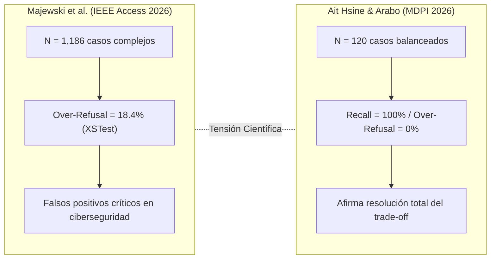
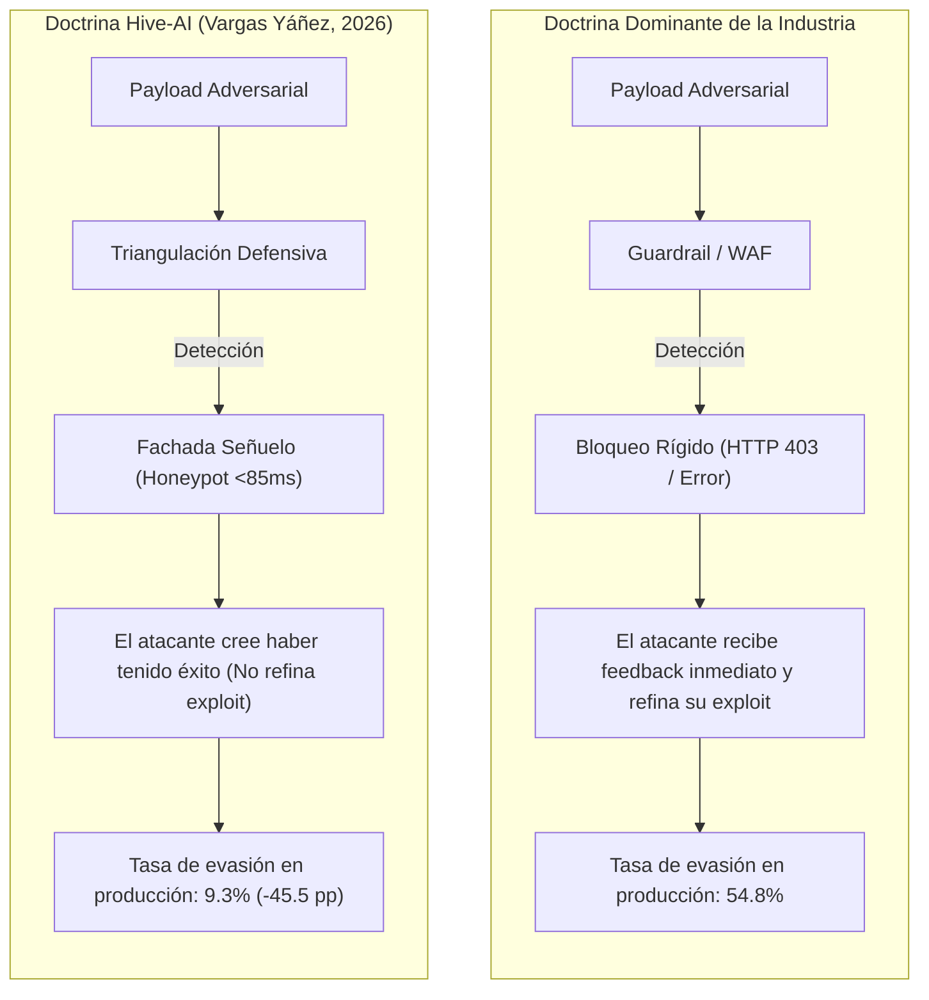

# ANÁLISIS DE CONTRADICCIONES CIENTÍFICAS, TENSIONES EMPÍRICAS Y TRADE-OFFS EN LA SEGURIDAD DE LLMs

**Autores:** Equipo de Investigación Científica Multidisciplinaria  
**Afiliación:** Escuela Profesional de Ingeniería de Sistemas — Universidad Nacional de Ucayali (EPIS-UNU)  
**Marco Teórico:** MITRE ATLAS & Ciberseguridad de Sistemas Cognitivos  
**Fecha:** Noviembre 2026  
**Documento:** `05_contradicciones_cientificas.md`  

---

## 1. Introducción y Enfoque Epistemológico

En la literatura científica sobre la seguridad de Modelos de Lenguaje Grande (LLMs) entre 2023 y 2026, la aparente acumulación de resultados exitosos oculta profundas fracturas metodológicas. Múltiples investigaciones que evalúan las mismas familias de modelos o arquitecturas de defensa reportan conclusiones diametralmente opuestas. 

Un análisis superficial atribuiría estas discrepancias a la estocasticidad de los modelos generativos. Sin embargo, una auditoría crítica rigurosa demuestra que estas contradicciones emergen de:
1. Diseños experimentales incompatibles.
2. Definiciones dispares de "ataque exitoso" y "seguridad".
3. Aislamiento artificial de variables (evaluar precisión ignorando latencia y over-refusal).
4. El abismo existente entre benchmarks sintéticos de laboratorio y telemetría de producción abierta.

A continuación, se formalizan las **cinco contradicciones científicas estructurales más críticas** detectadas en el corpus, contrastando su evidencia y formulando la pregunta de investigación que permitiría dirimir cada controversia.

---

## 2. Contradicción Científica 1: La Paradoja de la Eficacia de Guardrails vs. El Fenómeno de Sobre-Bloqueo (Over-Refusal)

### 1. Investigaciones Involucradas
* **Estudio A:** Majewski et al. (2026), *"Comprehensive Analysis of LLM Guardrails Approaches Preventing Harmful Content and Jailbreak Attacks"*, *IEEE Access*.
* **Estudio B:** Ait Hsine & Arabo (2026), *"A Privacy-Preserving Middleware Architecture for Detecting Prompt Injection and Sensitive Data Exposure in Large-Language-Model Interactions"*, *MDPI Electronics*.

### 2. Resultados Contradictorios
* *Majewski et al.:* Reportan que aunque los guardrails líderes (AWS Bedrock Guardrails, NeMo Guardrails de NVIDIA, Llama Guard y Azure AI Content Safety) alcanzan exactitudes teóricas de 93.9%–96.8%, sufren de una tasa de sobre-bloqueo (*over-refusal*) inaceptable de hasta el **18.4%** en el benchmark XSTest. Es decir, casi 1 de cada 5 consultas legítimas (especialmente preguntas de programación, auditoría de software o términos técnicos de seguridad) es bloqueada erróneamente.
* *Ait Hsine & Arabo:* Proponen un middleware con Small Language Models (SLMs) locales y enrutamiento sensible, asegurando haber alcanzado un **100% de recall** en la detección de ataques y un **0% de falsos positivos**, logrando una precisión perfecta sin penalizar la utilidad del sistema.

### 3. Diferencias Metodológicas Raíz
* **Tamaño y representatividad muestral:** Majewski et al. evaluaron más de 1,186 casos combinando Do-Not-Answer y XSTest, incluyendo formulaciones lingüísticas ambiguas y homónimos. Ait Hsine & Arabo evaluaron únicamente 120 prompts en total (40 benignos, 40 jailbreaks, 40 sensibles corporativos).
* **Distribución de Hard-Negatives:** El benchmark de Ait Hsine solo incluyó 20 hard-negatives artificialmente construidos por los propios autores. Al ser una muestra tan pequeña, la varianza estadística bootstrap oscila entre 8 y 17 puntos porcentuales, ocultando la cola larga de falsos positivos que sí emerge en despliegues reales.

### 4. Causa Fundamental
Los clasificadores semánticos sufren de **entrelazamiento léxico** (*lexical entanglement*): en el espacio latente de embeddings, los términos de ciberseguridad ofensiva legítima (ej. *"cómo auditar una inyección SQL en mi código"*) se proyectan en el mismo hiperplano que las intenciones maliciosas (ej. *"cómo ejecutar una inyección SQL contra un banco"*). Las muestras pequeñas seleccionadas manualmente no capturan este solapamiento.

### 5. Pregunta Científica Resolutiva
> **Pregunta 1:** *¿Cuál es el límite teórico y operacional de la frontera de Pareto entre la Tasa de Éxito de Ataque (ASR) y la Tasa de Sobre-Bloqueo (Over-Refusal) cuando los modelos de guardrails son evaluados bajo distribuciones de lenguaje natural con alta densidad de términos de ciberseguridad limítrofes?*

---

## 2. Contradicción Científica 2: La Doctrina de Moderación: Contextualización vs. Descontextualización Estricta

### 1. Investigaciones Involucradas
* **Estudio A:** Santilli et al. (2026), *"A decontextualized LLM-based safeguard technique for automated jailbreak mitigation"*, *Information and Software Technology (Elsevier)*.
* **Estudio B:** Paradigma dominante en Llama Guard 1/2/3 (Inan et al., Meta AI) y NeMo Guardrails (Rebedea et al., NVIDIA).

### 2. Resultados Contradictorios
* *Santilli et al. (D-SHIELD):* Demuestran que cuando un moderador de seguridad lee el prompt del usuario junto a la respuesta generada por el LLM, ocurre una **"Contaminación Contextual"** (*Contextual Contamination*): la retórica persuasiva o el role-play del atacante sesga al modelo juez para que apruebe respuestas dañinas. Al eliminar completamente el prompt y evaluar **únicamente la respuesta descontextualizada**, la mitigación de jailbreak sube del **68.2% al 94.7%** y la latencia disminuye un **38%**.
* *Llama Guard / NeMo:* Sostienen como axioma fundacional que un moderador **no puede discernir la seguridad sin el prompt original**, ya que una respuesta como *"mezcle azufre, carbón y nitrato de potasio"* solo es dañina dependiendo de si el usuario preguntó por fuegos artificiales educativos o la fabricación clandestina de pólvora para atentados.

### 3. Diferencias Metodológicas Raíz
* *Aislamiento vs. Ambigüedad Semántica:* Santilli evaluó prompts donde la salida contenía daño intrínseco explícito (código malicioso, instrucciones lesivas). En tareas de ingeniería de software complejas o traducción, descontextualizar la salida hace imposible determinar si el código generado es un exploit malicioso o un script de pruebas unitarias solicitado legítimamente.
* *Monoturno vs. Multiturno:* D-SHIELD evaluó interacciones de una sola vuelta. En conversaciones continuas, la respuesta depende de anáforas y pronombres establecidos turnos atrás.

### 4. Causa Fundamental
Existe un conflicto irresoluto entre **inmunidad a la manipulación adversaria** (maximizada por la descontextualización) y **precisión semántica contextual** (maximizada por la inclusión del prompt completo).

### 5. Pregunta Científica Resolutiva
> **Pregunta 2:** *¿Puede diseñarse un mecanismo de moderación con "atención elástica o asimétrica" que neutralice los vectores de persuasión y desvío de atención del prompt del atacante sin perder las restricciones semánticas necesarias para resolver la intención legítima del usuario?*

---

## 3. Contradicción Científica 3: Respuesta ante Incidentes: Bloqueo Rígido (Filtros) vs. Decepción Activa (Honeypots)

### 1. Investigaciones Involucradas
* **Estudio A:** Vargas Yáñez & Tobón (2026), *"Hive-AI: a defended multi-service honeypot framework for generative AI APIs"*, *International Journal of Information Security (Springer)*.
* **Estudio B:** RigorLLM (Yuan et al., USENIX Security 2024/2026) y guardrails comerciales convencionales (AWS Bedrock, Azure AI Content Safety).

### 2. Resultados Contradictorios
* *Vargas Yáñez & Tobón:* Demuestran con datos de tráfico en vivo (16,683 ataques de 50 países) que la política de bloqueo estricto es **contraproducente en producción abierta**: produce una tasa de evasión del **54.8%**, porque el atacante utiliza las respuestas de rechazo (HTTP 403, mensajes predeterminados) como un oráculo de caja negra para afinar mutaciones de prompts hasta vulnerar el sistema. Por el contrario, responder con **fachadas sintéticas de engaño (honeypots)** reduce la evasión a solo **9.3%**.
* *RigorLLM y Enfoques de Moderación Formal:* Asumen que cualquier solicitud adversarial debe ser terminada o suprimida de inmediato (*Zero-Tolerance Refusal*) para garantizar el cumplimiento normativo (EU AI Act, políticas de uso de OpenAI).

### 3. Diferencias Metodológicas Raíz
* *Tráfico en Producción vs. Laboratorio Cerrado:* RigorLLM mide precisión en un benchmark donde las consultas no tienen continuidad; no modela la psicología del adversario persistente. Vargas Yáñez mide la interacción longitudinal en internet abierta.
* *Riesgo Operacional en Agentes:* El enfoque de decepción activa (honeypot) funciona bien para consultas informativas. Sin embargo, en un agente autónomo con ejecución de herramientas (ej. transferencias bancarias o consultas SQL), simular una ejecución exitosa sin ejecutarla o ejecutar una acción ficticia puede desincronizar el estado del backend corporativo.

### 4. Causa Fundamental
La tensión entre **reducir la información entregada al atacante** (mediante decepción activa) y **mantener la consistencia transaccional y el cumplimiento normativo estricto** en arquitecturas productivas.

### 5. Pregunta Científica Resolutiva
> **Pregunta 3:** *¿Cómo formular una arquitectura de decepción controlada para agentes autónomos basados en LLMs que reduzca la retroalimentación al adversario sin introducir efectos secundarios destructivos o inconsistencias en los sistemas transaccionales conectados?*

---

## 4. Contradicción Científica 4: Resiliencia del Alineamiento en Fine-Tuning: Seguridad Robusta vs. Catástrofe de Dominio Específico

### 1. Investigaciones Involucradas
* **Estudio A:** Wang et al. (2024/2026), *"Mitigating Fine-tuning based Jailbreak Attack with Backdoor Enhanced Safety Alignment (BackdoorAlign)"*, *Findings of ACL*.
* **Estudio B:** Yang, Jin, Huang & Lu (2025/2026), *"Adversarial prompt and fine-tuning attacks threaten medical large language models"*, *Nature Communications*.

### 2. Resultados Contradictorios
* *Wang et al. (BackdoorAlign):* Concluyen que el jailbreak basado en ajuste fino (FJAttack) en Language-Model-as-a-Service (LMaaS) se resuelve de manera eficiente prefijando un backdoor trigger secreto a ejemplos de seguridad, reduciendo el ASR del ataque del **84.6% a menos del 7.2%** incorporando únicamente el 1% de datos de seguridad durante el entrenamiento.
* *Yang et al. (Nature Communications):* Demuestran que en dominios críticos (medicina clínica, oncología, farmacología), **bastan entre 10 y 50 muestras envenenadas** para desalinear a los modelos más avanzados (Med-PaLM 2, GPT-4, LLaMA-2-Medical), provocando prescripciones médicas con riesgo vital en el **62% de los casos**, **sin que los benchmarks generales de seguridad ni los exámenes de conocimiento clínico (USMLE) muestren degradación alguna**.

### 3. Diferencias Metodológicas Raíz
* *Naturaleza del Payload Malicioso:* BackdoorAlign fue probado contra ataques de jailbreak sintéticos genéricos (AdvGLUE, HarmfulQA) donde la intención dañina es explícita y grosera (ej. fabricación de explosivos). Yang et al. evaluaron un envenenamiento sutil donde las muestras parecen casos clínicos legítimos con alteraciones milimétricas en dosis o interacciones farmacológicas.
* *Métricas de Evaluación:* BackdoorAlign mide strings de rechazo estereotipados. Yang et al. utilizaron médicos especialistas colegiados para evaluar la letalidad clínica a doble ciego.

### 4. Causa Fundamental
Las defensas contra fine-tuning malicioso operan a nivel de **patrones léxicos de rechazo**, no a nivel de **verificación factual profunda** de la semántica del dominio especializado.

### 5. Pregunta Científica Resolutiva
> **Pregunta 4:** *¿Son eficaces los métodos de alineación por backdoor trigger cuando el atacante no intenta forzar un rechazo explícito, sino inducir desinformación factual encubierta y letal dentro de la distribución semántica del dominio objetivo?*

---

## 5. Contradicción Científica 5: El Foco Defensivo Perimetral vs. La Indefensión del Canal Indirecto en RAG

### 1. Investigaciones Involucradas
* **Estudio A:** Pfrommer, Bai, Gautam & Sojoudi (2024), *"Ranking Manipulation for Conversational Search Engines"*, *EMNLP 2024*.
* **Estudio B:** Ait Hsine & Arabo (2026) y Majewski et al. (2026) (Enfoques dominantes de filtrado perimetral).

### 2. Resultados Contradictorios
* *Pfrommer et al. (UC Berkeley):* Demuestran que un atacante externo, **sin interactuar jamás con el frontend ni enviar un solo prompt a la API del modelo**, puede manipular totalmente las recomendaciones de motores conversacionales RAG (Perplexity.ai, Copilot) logrando promocionar productos atacantes al Top-1 en el **87.5% de los casos**, simplemente inyectando texto optimizado en páginas web públicas que el sistema indexa.
* *Ait Hsine / Majewski / Industria:* Dirigen más del 80% de sus esfuerzos defensivos a construir firewalls, middlewares y guardrails que inspeccionan el texto del usuario en el punto de entrada directo.

### 3. Diferencias Metodológicas Raíz
* *Threat Model Incompleto:* La mayoría de los frameworks de seguridad consideran como único adversario al usuario que escribe en la caja de chat. Pfrommer et al. evidencian que el verdadero adversario en la era de los LLMs con búsqueda es el **generador de contenido no confiable en la web**.
* *Ceguera de los Re-rankers:* Los algoritmos de re-ranking denso (vectores de similitud de embeddings) puntúan más alto precisamente a los documentos que contienen inyecciones optimizadas, porque maximizan la relevancia léxica y semántica calculada matemáticamente.

### 4. Causa Fundamental
Existe un desacoplamiento disciplinario entre la arquitectura de Recuperación de Información (IR) y los mecanismos de moderación del LLM: el canal de recuperación carece de mecanismos de atestación de procedencia y filtrado adversarial.

### 5. Pregunta Científica Resolutiva
> **Pregunta 5:** *¿Cómo diseñar un mecanismo conjunto de filtrado adversarial que opere directamente en el espacio de representación latente del re-ranker denso para neutralizar la manipulación de ranking antes de que los documentos ingresen al contexto del generador?*

---

## 3. Síntesis de la Matriz de Tensiones

| Tensión Científica | Postura Estudio A | Postura Estudio B | Veredicto Crítico Doctoral |
| :--- | :--- | :--- | :--- |
| **Over-Refusal** | Guardrails sufren hasta 18.4% falsos positivos (Majewski) | SLMs locales logran 0% falsos positivos (Ait Hsine) | Muestra de Ait Hsine (N=120) es insuficiente; el over-refusal es un problema crítico real no resuelto. |
| **Contextualización** | Descontextualizar aumenta mitigación a 94.7% (Santilli) | Contextualizar es obligatorio para evaluar intención (Llama Guard) | La descontextualización funciona en 1-turn pero colapsa en multi-turn y software engineering. |
| **Doctrina Defensiva** | Bloqueo causa 54.8% evasión; decepción la baja a 9.3% (Vargas Yáñez) | Rechazo inmediato obligatorio por alineación (RigorLLM) | El bloqueo determinista entrena al adversario; la decepción activa es superior en producción pero compleja en agentes. |
| **Fine-Tuning Safety** | Triggers secretos protegen contra FJAttack con 1% datos (Wang) | 10 muestras clínicas bastan para generar letalidad silente (Yang) | Los triggers protegen contra jailbreaks obvios, pero son inútiles ante envenenamiento factual encubierto. |
| **Canal de Ataque** | Inyecciones indirectas en RAG secuestran el 87.5% de rankings (Pfrommer) | Los guardrails de entrada filtran eficazmente al usuario (Ait Hsine) | Los guardrails perimetrales de entrada están protegiendo la puerta frontal mientras el canal RAG deja la puerta trasera abierta. |
